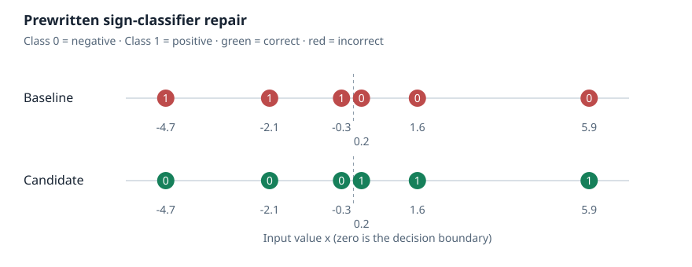

# Weight Space Lab

A local toolkit for inspecting, patching, and evaluating neural-network weights.

The toolkit connects **inspect → edit → evaluate → compare → review evidence**,
with bounded feedback, candidate freezing, and matched final evaluation for small
independent experiments. It is a separate project from the upstream research it
reproduces; reproduction results are attributed to their original authors.



*Generated from the working offline demo. The patch is prewritten: six fixed
examples improve from 0/6 to 6/6, with two stored entries changed. This is a tools
demonstration, not agent discovery or benchmark evidence.*

## First run

Requires Python 3.11+ and [uv](https://docs.astral.sh/uv/getting-started/installation/).
The first invocation may download NumPy/SafeTensors packages. The demonstration
itself uses only the CPU: no credentials, model downloads, GPU, or external services.

```bash
uv run --script lab.py demo runs/sign-demo
```

Open `runs/sign-demo/report.html` directly in a browser. It contains the exact patch
and rationale, before/after visualization, per-example outcomes, fixed and regressed
IDs, changed-entry counts, checkpoint hashes, and links to the JSON records.
The HTML is self-contained and needs no server. Every run requires a new output
directory; repeating the command fails without modifying the old result.

For a strictly offline invocation after installing `requirements.txt`:

```bash
python lab.py demo runs/offline-demo
python lab.py verify runs/offline-demo
```

[First experiment guide](docs/FIRST_EXPERIMENT.md) explains setup, artifacts,
supported edits, rollback, and metadata export.

## Independent research controller

The controller meters proposals and practice feedback, records rejected/failed
attempts, freezes one candidate, and permits one matched held-out comparison.
It measures regressions as well as repairs. Budgets, input hashes, code versions,
candidate identities, and an event hash chain remain in the run record.

```bash
python lab.py experiment create runs/threshold-study --proposal-budget 5 --feedback-budget 3
python lab.py experiment status runs/threshold-study
```

The first original protocol asks whether an editor can repair a shifted classifier
under a one-entry bias-edit budget while preserving protected predictions. Its
success criterion is declared before feedback. The held-out draw uses a fresh
private seed and a dataset-hash commitment.

To validate the controller with **prewritten positive and regressing controls**:

```bash
python scripts/check_controller.py runs/controller-check
```

This produces `runs/controller-check/final/report.html`. It is manual infrastructure
validation, not a new agent research result. An external-agent study has not been
executed. Read the [protocol](experiments/threshold-repair/PROTOCOL.md) before running
one. The controller is a logical gate, **not an OS sandbox**; an operator must
supply editor isolation and retain the editor's model identity and transcript.

### Recorded editor interface

A bounded JSONL interface now exposes inspection, inline patch proposals, practice
feedback, freezing and abstention to an externally managed editor. It records the
declared editor configuration, prompts and tool transcript; budgets survive
reconnects. Final evaluation remains a separate operator action.

```bash
python scripts/check_editor_session.py runs/editor-transport-check
python lab.py editor audit runs/editor-transport-check scripted
```

This exercises the real stdio CLI with a **prewritten control**, then separately
evaluates the frozen candidate. It invokes no model and establishes no external
agent result. See [editor sessions](docs/EDITOR_SESSIONS.md) for the wire contract,
private records, isolation requirements and external harness setup.

## Model weight-editing benchmark

Compare API editors on four small target-model tasks: threshold, slope, feature
routing and hidden-layer repair. Every editor receives byte-matched checkpoints,
practice sets and held-out draws, with identical tool and feedback upper limits.
The scorecard records success, repair accuracy, regressions, tool errors, usage,
failures and all predeclared trial slots. Scripted controls stay separate.

```bash
python lab.py benchmark create runs/editing-suite --config experiments/editing-benchmark/pilot.example.json
python lab.py benchmark run runs/editing-suite
python lab.py benchmark audit runs/editing-suite
```

The default run executes **offline controls only** and writes
`runs/editing-suite/scorecard.html`. The example prepares Claude plus Fireworks-hosted
DeepSeek, Kimi and MiniMax; those trials remain pending. Live API calls require
separate authorization, provider keys and `--allow-paid-api`. No paid model results
are included. See the [benchmark guide](docs/BENCHMARK.md) for task definitions,
native provider adapters, accounting, estimated-spend limits and interpretation.

## Existing checkpoint workflows

All paths below are repository-relative. Install `requirements.txt` first, or use
the pinned `uv run --script lab.py` entry point.

```bash
python lab.py --help
python lab.py inspect runs/sign-demo/original.npz
python lab.py tensor runs/sign-demo/original.npz weight --start 0 --count 2
python lab.py edit runs/sign-demo/original.npz runs/sign-demo/edit.json runs/another-candidate --max-fraction 0.5
python lab.py evaluate runs/another-candidate/model.npz runs/sign-demo/architecture.json runs/sign-demo/heldout.json --output runs/another-evaluation.json
python lab.py compare runs/sign-demo/baseline.json runs/another-evaluation.json
python lab.py export-evidence runs/sign-demo runs/sign-evidence
```

The generic evaluator supports explicitly described dense MLP classifiers. It does
not evaluate arbitrary transformers. Generic editing supports one NPZ/SafeTensors
file and F16/F32/F64 edits; the model-specific BF16 Qwen route is separate.

## Upstream reproductions

### MinAtar Breakout — CPU

This reproduces Takehi et al.'s published Experiment 5 network. It downloads pinned
public research assets and retains their licenses. It does not generate a fresh
network or consume hosted-model allowance.

```bash
uv run --with minatar==1.0.15 --script lab.py breakout runs/breakout-smoke --mode smoke
```

The default smoke run uses 8 episodes, seed 0, and at most 1,000 steps per episode.
Its local report includes a replay of episode zero, selected in advance. Smoke
scores are explicitly separate from full benchmark results.

The full CPU protocol is longer: 1,000 episodes, at most 10,000 steps each.

```bash
uv run --with minatar==1.0.15 --script lab.py breakout runs/breakout-full --mode full
```

Fresh agent generation is a separate, explicit opt-in operation using the existing
Codex sign-in and model allowance. It is never called by the demo, smoke workflow,
or controller. See the [Breakout guide](docs/BREAKOUT.md) for that command and its
costs, attribution, evidence limits, and protocol differences.

### Published Qwen p50c edit — separate GPU environment

```bash
python lab.py qwen --help
```

The [Qwen guide](qwen/README.md) describes large model/data downloads, the isolated
Linux/WSL environment, BF16 reconstruction, and GPU evaluation. Both edited tensor
hashes and a two-question pilot were verified; full MATH-500 results remain pending.
No fresh Qwen edit-discovery system is implemented.

## Evidence, installation, and development

- [Research protocol](experiments/threshold-repair/PROTOCOL.md): budgets, freezing, held-out evaluation, interpretation.
- [Evidence guide](evidence/README.md): upstream versus local results, sanitized records, and limitations.
- [Implementation/results report](docs/REPORT.md): the dated reconstruction and pilot snapshot.
- [Verification record](docs/VERIFICATION.md): commands actually executed for this change.
- [Plugin installation](docs/INSTALLATION.md): Codex and DeepSeek Harness; existing CLIs remain available.
- [CLI reference](skills/weight-space-lab/references/cli.md): generic formats and limits.

```bash
python -m unittest discover -s tests -p 'test_*.py' -v
python -m unittest discover -s qwen -p 'test_*.py' -v
node --test tests/plugin.test.mjs
python scripts/package.py
```

The Qwen unit tests additionally need PyTorch and the pinned grader packages;
they do not launch inference. One optional legacy Breakout integration test skips
when its specific reference directory is absent.

Project code is [MIT licensed](LICENSE). Upstream research, assets and third-party
dependencies retain their own terms; see [NOTICE.md](NOTICE.md). This repository
does not claim authorship of the upstream study, its discoveries, or its popularity.
