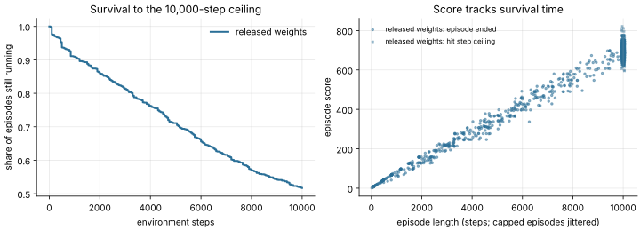
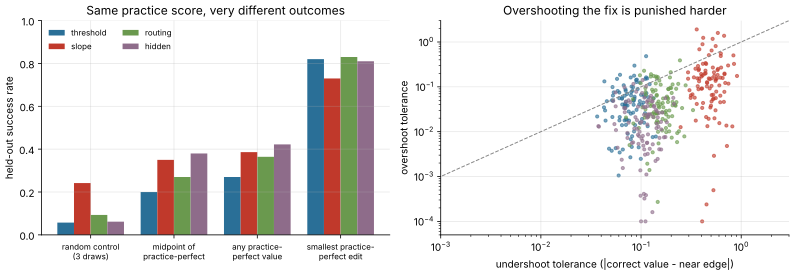

# Weight Space Lab

A local lab for **weight-space programming**: changing what a neural network does by
writing or editing its parameters directly, without gradient training, and keeping
an auditable record of every edit and measurement.

The lab has three strands:

1. **Attributed reproductions** of Takehi et al.'s
   [weight-space programming experiments](https://github.com/RikiyaT/lm_understand-logs).
   A MinAtar Breakout policy was written from scratch by a language model; a published
   BF16 edit (p50c) was applied to Qwen3.5-0.8B for MATH-500. The research, networks and
   edits belong to the original authors.
2. **An original benchmark** of language models as weight editors. Matched synthetic
   repair tasks, metered practice feedback, one frozen candidate and a single held-out
   evaluation.
3. **The tooling** both rely on. Checkpoint inspection and bounded edits, a budgeted
   research controller, a recorded editor interface, and hash-ledgered reports.

**Start here:** the [lab notebook](docs/LAB_NOTEBOOK.md) (what exists, what each
experiment showed, what is broken) and the [roadmap](docs/ROADMAP.md) (the next
experiments, ranked).

## What has been found so far

As of November 10, 2026. Every number links to committed evidence or a recorded run.

### Breakout: a hand-written policy network ([RESULTS.md](RESULTS.md), [evidence](evidence/))

| Network (600-32-32-6 tanh, MinAtar Breakout) | Mean score | SE | Episodes |
|---|---:|---:|---:|
| Published (Takehi et al.) | 517.411 | 7.417 | 1,000 |
| Released weights, local replay | **502.880** | 7.747 | 1,000 |
| Fresh tool-free GPT-6 Astra response, local | 511.530 | 5.547 | 1,000 |
| Published PPO, best at 100M / 500M steps (reference only) | 15.779 / 25.344 | — | — |

- **The local replay reproduces exactly.** A fresh 1,000-episode run on November 10, on
  a different machine and Python version, gave 502.880 ± 7.747 again, in 62 seconds on 3 CPU workers
  ([evidence](evidence/breakout-full-replay/)). It sits 1.35 combined SEs below the
  published mean.
- The fresh network matches the released one but is not better: +8.65 points, with a
  paired SE of 9.00.
- **The score mostly measures survival.** 517 of 1,000 episodes hit the
  10,000-step ceiling, and episode length explains 98% of score variance (r = 0.992,
  about 0.069 points per step)
  ([analysis](experiments/breakout-ceiling/README.md)).
- **The released network is an 815-weight program.** Only 815 of 20,486 parameters are
  nonzero, across 6 first-layer units, 8 second-layer units and 2 action logits.
  Zeroing any single first-layer unit drops the mean score from 481.7 to at most 8.4
  over 200 episodes ([pilot](experiments/breakout-circuit/README.md)). The fresh network
  has 1,076 nonzero weights.



### Qwen p50c: a published LLM weight edit ([report](docs/REPORT.md), [evidence](evidence/qwen/))

- **The reconstruction is exact.** 130,188 BF16 entries changed (65,260 in the layer 15
  MLP down-projection, 64,928 in layer 19). Both edited-tensor hashes match, and the
  other 318 exported tensors are bitwise unchanged.
- **Pilot only:** 2 MATH-500 problems × 4 samples at a 32,768-token ceiling. The
  original got 1/8 correct, p50c 6/8. The original hit the token ceiling on 8/8
  samples, p50c on 1/8. The original's only correct sample was itself cut off at the
  ceiling, which suggests the gain may be mostly about *finishing*
  ([roadmap #1](docs/ROADMAP.md)).
- The full 500-problem comparison has not been committed. **No MATH-500 accuracy claim
  is made.**

### Weight-editing benchmark ([guide](docs/BENCHMARK.md), [verification](docs/VERIFICATION.md))

The benchmark has four synthetic families (threshold, slope, routing, hidden), each with
exactly one editable entry and a known repair. Success requires at least 90% repair
accuracy and zero regressions on 256 held-out examples.

- **Controls** (12-case calibration): feasible 12/12, no-op 0/12, random 1/12
  (recorded) and 2/12 (rerun on November 10).
- **Task geometry, 400 cases** ([analysis](experiments/task-geometry/README.md)):
  - The random control's expected success rate is **11.4%**.
  - A value that scores 32/32 on practice passes the held-out rule only **27–42%** of
    the time.
  - Overshoot tolerance is 2–7× tighter than undershoot, so the **smallest edit that
    is perfect on practice succeeds 73–83%**, while the middle of the practice-perfect
    range succeeds 20–38%.
- **Model pilots are not a ranking.**
  - Codex CLI froze 255/256 with 100% repair and 1 regression, failing the rule. All
    three Codex attempts so far show this overshoot pattern.
  - Claude CLI stopped with a structured-output error before selecting anything. This
    is probably caused by the harness setting zero structured-output retries
    ([notebook](docs/LAB_NOTEBOOK.md), finding 1).
  - No native API trials have run.



**Not established yet:** any MATH-500 result; any model ranking as weight editors; any
external-agent controller trial; fresh LLM edit discovery; editing of arbitrary
transformers through the generic tools.

## Quick start

Requires Python 3.11+. With [uv](https://docs.astral.sh/uv/getting-started/installation/),
the offline demo needs no other setup, credentials, GPU or downloads beyond Python
packages:

```bash
uv run --script lab.py demo runs/sign-demo
```

Open `runs/sign-demo/report.html` in a browser. It shows the exact patch, a
before/after plot, per-example outcomes, hashes and links to every JSON record. The
patch is prewritten: six fixed examples go from 0/6 to 6/6 with two stored entries
changed. This is a tools demonstration, not discovery.


For a plain Python environment, install `requirements.txt`, then:

```bash
python lab.py demo runs/offline-demo
python lab.py verify runs/offline-demo
```

Every command writes into a **new** output directory and refuses to overwrite an
existing one. The [first experiment guide](docs/FIRST_EXPERIMENT.md) covers setup,
artifacts, supported edits, rollback and metadata export.

### Reproduce today's checks (CPU only)

```bash
python -m unittest discover -s tests -p 'test_*.py'
python scripts/check_controller.py runs/controller-check
python scripts/check_benchmark.py runs/benchmark-validation
uv run --with minatar==1.0.15 --script lab.py breakout runs/breakout-full --mode full --workers 3
python experiments/breakout-ceiling/analyze.py evidence/breakout-full-replay/evidence.json --label "released weights" --output runs/breakout-ceiling
python experiments/task-geometry/analyze.py --from-cases evidence/task-geometry/cases.json --output runs/task-geometry
```

The full Breakout run downloads six pinned public research assets and takes about a
minute on 3 cores. The geometry analysis reruns from committed per-case data in
seconds, or from scratch in about 10 minutes when `--from-cases` is omitted.

## What is in the lab

| Component | Status | Guide |
|---|---|---|
| Checkpoint toolkit: inspect, tensor slices, bounded set/add/scale/direction edits, MLP evaluator, paired compare | Working; one NPZ/SafeTensors file, F16/F32/F64 | [CLI reference](skills/weight-space-lab/references/cli.md) |
| Research controller: metered proposals/feedback, freeze, one matched final evaluation | Working; validated with manual controls only | [protocol](experiments/threshold-repair/PROTOCOL.md) |
| Recorded JSONL editor interface for external editors | Working; scripted control only | [editor sessions](docs/EDITOR_SESSIONS.md) |
| Weight-editing benchmark with Claude/Fireworks API and Claude/Codex CLI adapters | Working; API trials pending | [benchmark](docs/BENCHMARK.md), [CLI editors](docs/CLI_EDITORS.md) |
| MinAtar Breakout reproduction | Working end to end on CPU | [Breakout guide](docs/BREAKOUT.md) |
| Qwen p50c reconstruction and MATH-500 runner | Reconstruction verified; full run pending | [Qwen guide](qwen/README.md) |
| Configurable single-host GPU layouts | Open in PR [ZayneMason/weight-space-lab#4](https://github.com/ZayneMason/weight-space-lab/pull/4) | — |
| Codex plugin and DeepSeek Harness bundle | Node tests pass | [installation](docs/INSTALLATION.md) |

### Research controller

The controller meters proposals and practice feedback, records rejected and failed
attempts, freezes one candidate and permits one matched held-out comparison. Budgets,
input hashes, code versions, candidate identities and an event hash chain stay in
the run record.

```bash
python lab.py experiment create runs/threshold-study --proposal-budget 5 --feedback-budget 3
python lab.py experiment status runs/threshold-study
python scripts/check_controller.py runs/controller-check   # prewritten positive and regressing controls
```

The controller is a logical gate, **not an OS sandbox**. An operator must supply
editor isolation and keep the editor's model identity and transcript. Read the
[protocol](experiments/threshold-repair/PROTOCOL.md) before running an external-agent
study.

### Recorded editor interface

A bounded JSONL interface gives an externally managed editor inspection, inline patch
proposals, practice feedback, freezing and abstention. It records the declared editor
configuration, prompts and tool transcript, and budgets survive reconnects. Final
evaluation stays a separate operator action.

```bash
python scripts/check_editor_session.py runs/editor-transport-check
python lab.py editor audit runs/editor-transport-check scripted
```

### Weight-editing benchmark

```bash
python lab.py benchmark create runs/editing-suite --config experiments/editing-benchmark/pilot.example.json
python lab.py benchmark run runs/editing-suite      # offline controls only
python lab.py benchmark audit runs/editing-suite
```

The default run executes only the scripted controls and writes
`runs/editing-suite/scorecard.html`. Live API calls require separate authorization,
provider keys and `--allow-paid-api`. Existing Claude/Codex CLI sign-ins use
`--allow-cli` ([CLI editors](docs/CLI_EDITORS.md)). Every planned trial slot stays in
the denominator; failures and abstentions are never silently rerun.

### Checkpoint workflows

```bash
python lab.py inspect runs/sign-demo/original.npz
python lab.py tensor runs/sign-demo/original.npz weight --start 0 --count 2
python lab.py edit runs/sign-demo/original.npz runs/sign-demo/edit.json runs/another-candidate --max-fraction 0.5
python lab.py evaluate runs/another-candidate/model.npz runs/sign-demo/architecture.json runs/sign-demo/heldout.json --output runs/another-evaluation.json
python lab.py compare runs/sign-demo/baseline.json runs/another-evaluation.json
python lab.py export-evidence runs/sign-demo runs/sign-evidence
```

The generic evaluator supports explicitly described dense MLP classifiers. It does not
evaluate arbitrary transformers. The BF16 Qwen route is separate.

### Upstream reproductions

**MinAtar Breakout (CPU).** The smoke run uses 8 episodes, seed 0 and at most 1,000
steps. The full protocol is 1,000 episodes with at most 10,000 steps each. Fresh
network generation is a separate, explicit opt-in that uses the Codex sign-in; the
demo, smoke run and controller never call it. See the
[Breakout guide](docs/BREAKOUT.md).

```bash
uv run --with minatar==1.0.15 --script lab.py breakout runs/breakout-smoke --mode smoke
```

**Qwen p50c (separate Linux GPU environment).** `python lab.py qwen --help`. The
[Qwen guide](qwen/README.md) covers the large downloads, the isolated environment,
BF16 reconstruction and GPU evaluation. No fresh Qwen edit discovery is implemented.

## Evidence, docs and development

- [Lab notebook](docs/LAB_NOTEBOOK.md) and [roadmap](docs/ROADMAP.md).
- [Evidence guide](evidence/README.md): upstream versus local results, sanitized
  records, limitations.
- [Implementation/results report](docs/REPORT.md): the November 4 reconstruction and
  pilot snapshot.
- [Verification record](docs/VERIFICATION.md): commands executed for earlier changes.
- [Plugin installation](docs/INSTALLATION.md): Codex and DeepSeek Harness.

```bash
python -m unittest discover -s tests -p 'test_*.py' -v
python -m unittest discover -s qwen -p 'test_*.py' -v
node --test tests/plugin.test.mjs
python scripts/package.py
```

The Qwen unit tests also need PyTorch and the pinned grader packages; they do not
launch inference. One optional legacy Breakout integration test skips when its
reference directory is absent.

Project code is [MIT licensed](LICENSE). Upstream research, assets and third-party
dependencies keep their own terms; see [NOTICE.md](NOTICE.md). This repository does
not claim authorship of the upstream study, its discoveries or its networks.
