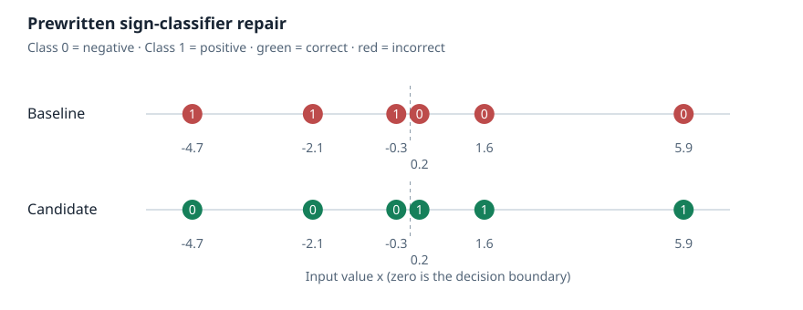

# Weight Space Lab

GPU 配置支持单机 NVIDIA/CUDA：单卡、多卡独立 worker，以及 tensor/pipeline
并行分组。`python lab.py gpu inspect` 查看设备，`python lab.py gpu plan --config experiments/gpu-layouts/auto.json`
只生成规划，不占用 GPU 显存。执行 Qwen 评估需要 Linux/WSL 和显式 `--execute`。
详见 [GPU 配置指南](docs/GPU_CONFIG.md)；实际能否运行取决于模型、引擎支持和可用显存。

用于检查、修改和评估神经网络权重的本地工具集。

统一流程：**检查 → 编辑 → 评估 → 比较 → 审查证据**。项目独立于上游研究，
明确区分工具功能、上游实验复现、预先编写的验证示例，以及尚未执行的代理研究。



图来自实际运行的离线示例：预先编写的补丁修改两个存储项，使六个固定示例从
0/6 正确变为 6/6。这是工具演示，不是代理自主发现或基准提升。

## 首次运行

需要 Python 3.11+ 和 uv。首次运行可能下载 NumPy/SafeTensors 软件包；实验本身
仅使用 CPU，不需要凭据、模型下载、GPU、服务器或外部服务。

```bash
uv run --script lab.py demo runs/sign-demo
```

直接在浏览器打开 `runs/sign-demo/report.html`。报告包含实际补丁、理由、前后
行为图、修复和回归的示例、改动数量、检查点哈希及 JSON 记录链接。输出目录必须
是新目录；重复运行会清晰失败并保留之前的全部输出。

预先安装 `requirements.txt` 后，可完全离线运行：

```bash
python lab.py demo runs/offline-demo
python lab.py verify runs/offline-demo
python lab.py export-evidence runs/offline-demo runs/offline-evidence
```

详见 [首次实验指南](docs/FIRST_EXPERIMENT.md)。

## 独立研究控制器

控制器限制候选提交和练习反馈次数，记录拒绝与失败，冻结一个候选，并仅允许
一次与原始模型条件匹配的最终留出集评估。结果同时报告修复和回归。

```bash
python lab.py experiment create runs/threshold-study --proposal-budget 5 --feedback-budget 3
python lab.py experiment status runs/threshold-study
python scripts/check_controller.py runs/controller-check
```

最后一条命令使用预先编写的正确和回归补丁验证控制器，输出
`runs/controller-check/final/report.html`，不代表代理研究结果。首个独立协议研究
单项偏置编辑预算下的阈值修复，并保护其他预测。最终数据使用新的私密随机种子，
在反馈前固定哈希。尚未执行外部代理试验。

控制器是协议层面的约束，**不是操作系统安全沙箱**。实际代理试验需要操作者
提供文件系统和计算隔离，保留模型身份及交互记录。详见
[研究协议](experiments/threshold-repair/PROTOCOL.md)。

### 编辑器交互记录

JSONL 接口向外部管理的编辑器提供权重检查、内联补丁提交、练习反馈、候选冻结
和放弃操作，并记录声明的模型配置、提示词及工具交互。重新连接不会重置全局
预算；最终留出集评估始终由操作者单独执行。

```bash
python scripts/check_editor_session.py runs/editor-transport-check
python lab.py editor audit runs/editor-transport-check scripted
```

以上命令使用**预先编写的控制补丁**验证真实标准输入/输出接口，并在编辑器退出
后评估冻结候选。不调用模型，不代表外部代理研究结果。接口不提供操作系统隔离，
记录包含私密提示词，不能自动发布。通信格式、外部工具适配、隔离和审计说明见
[编辑器交互指南](docs/EDITOR_SESSIONS.md)。

## 模型权重编辑测试套件

套件包含阈值、斜率、特征路由和 ReLU 隐层权重修复。各编辑器使用相同的原始
检查点、练习样本和最终留出样本，并遵守相同的工具与反馈预算。结果记录成功率、
修复、回归、工具错误、API 使用量，以及全部预先声明的试验（包括失败和待运行项）。

```bash
python lab.py benchmark create runs/editing-suite --config experiments/editing-benchmark/pilot.example.json
python lab.py benchmark run runs/editing-suite
python lab.py benchmark audit runs/editing-suite
```

默认仅运行**离线预编写控制组**，生成 `runs/editing-suite/scorecard.html`。
示例配置包括 Claude 以及 Fireworks 上的 DeepSeek、Kimi 和 MiniMax；API 试验保持
待运行；CLI 小规模验证及失败另见验证记录。原生 API 调用需另行授权、环境变量凭据以及
`--allow-paid-api`。金额限制是预估用量保护，不是提供商账单的硬性上限；详见
[测试套件指南](docs/BENCHMARK.md)。本套件测试小型 MLP 的单项编辑，不代表通用
Transformer 权重编程能力。

也可使用现有 Claude/Codex CLI 登录，见
[CLI 编辑器及 Fireworks 密钥输入](docs/CLI_EDITORS.md)。`--allow-cli` 仅授权 CLI
编辑器；付费 API 仍需单独启用。Windows 密钥窗口提供隐藏输入，仅传给新终端会话，
不写入文件。CLI 与原生 API 工具调用分别标记，不直接混合排名。

## 已有模型适配器

```bash
python lab.py inspect runs/sign-demo/original.npz
python lab.py edit --help
python lab.py evaluate --help
python lab.py compare --help
python lab.py qwen --help
```

通用编辑支持单个 NPZ/SafeTensors 文件及 F16/F32/F64。通用评估仅支持明确描述
的全连接 MLP，不能用于任意 Transformer。Qwen 的 BF16 重建使用单独适配器。

### 上游 MinAtar Breakout 复现（CPU）

复现对象是 Takehi 等人的已发布实验 5 网络。命令下载固定版本的公开研究资源，
保留许可证，不执行新网络生成，不消耗托管模型额度。

```bash
uv run --with minatar==1.0.15 --script lab.py breakout runs/breakout-smoke --mode smoke
uv run --with minatar==1.0.15 --script lab.py breakout runs/breakout-full --mode full
```

默认冒烟测试：8 局、种子 0、每局最多 1,000 步，包含预先选定的第 0 局回放。
完整协议：1,000 局、每局最多 10,000 步。冒烟分数不作为完整基准结果。
新代理网络生成必须明确选择，并会使用现有 Codex 登录和模型额度；详见
[Breakout 指南](docs/BREAKOUT.md)。

### 上游 Qwen p50c 编辑（独立 GPU 环境）

两项 BF16 编辑张量哈希和两道题目的试验已验证；完整 MATH-500 结果尚未完成。
模型与数据需要较大下载，推理需要 GPU。尚未实现新 Qwen 编辑发现。详见
[Qwen 指南](qwen/README.md)。

## 文档与验证

[结果报告](docs/REPORT.md) · [证据及限制](evidence/README.md) ·
[实际验证记录](docs/VERIFICATION.md) · [插件安装](docs/INSTALLATION.md)

原有 CLI 和 Codex/DeepSeek Harness 插件接口保留。项目代码采用 MIT 许可证；
上游研究和资源保留原有许可，见 [NOTICE.md](NOTICE.md)。本项目不声称是上游研究
的作者，也不把上游研究的影响力作为本仓库的使用量或成果。
