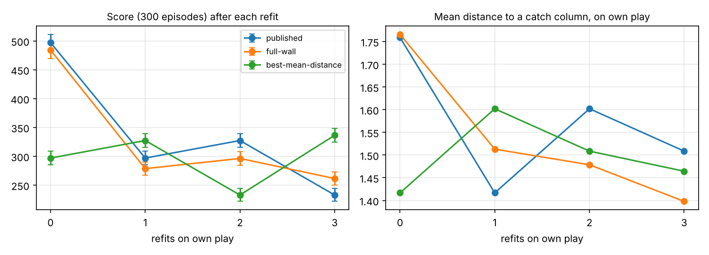

# Refitting the guesses on their own play (roadmap #11)

**Date:** November 16, 2026 · **Status:** done · **Cost:** CPU, about an hour

[Roadmap #9](HEDGE.md) left a gap: brick-blind ascending tables fitted for accuracy on the
published network's play score about 100–200 points below the author's earliest-bounce
table. One untested explanation was distribution shift: a table fitted to the states the
published network visits changes which states occur once installed. This experiment
closes the loop: refit each table on its own play and repeat.

```bash
python experiments/breakout-anatomy/closedloop.py CHECKPOINT --output runs/breakout-closedloop
```

## Method

- Three starting tables: the author's (published), the physics-only full-wall table from
  #9, and #8's best-mean-distance table (identical on all 180 cells to #8's).
- Each round installs the table in units 2 and 3, plays held-out episodes 5000–5049, refits
  every visited cell to minimise mean distance to the true catch columns (unvisited cells
  keep their value), and scores the table on 300 episodes. Three refits per chain; the last
  table of each chain is scored at the full protocol (1,000 episodes, sticky 0.1).
- The published chain's first refit is the best-mean-distance table, and both runs give the
  same quick score (297.0), a check that the chains are deterministic.

## Results (measured)

| Chain | Start (300 ep.) | Refit 1 | Refit 2 | Refit 3 | Refit 3, full protocol |
|---|---:|---:|---:|---:|---:|
| published | 497.2 | 297.0 | 327.4 | 232.9 | 238.6 ± 6.2 |
| full wall | 484.3 | 278.7 | 296.3 | 261.5 | 278.4 ± 6.1 |
| best mean distance | 297.0 | 327.4 | 232.9 | 336.4 | 319.3 ± 6.5 |

Standard errors on the 300-episode scores are 11–15.



1. **Distribution shift is real.** The best-mean-distance table is 1.11 columns off on the
   published network's play but 1.42 off on its own.
2. **Closing the loop does not close the gap.** No refit of any chain scores above 340 on
   300 episodes, and the chains do not settle: scores move by 18–103 points between rounds
   while 31–177 cells change.
3. **One accuracy refit is enough to lose the author's advantage.** Refitting the published
   table once on its own play drops it from 497 to 297; refitting the physics-only table
   drops it from 484 to 279.
4. Accuracy on own play stays between 1.40 and 1.60 columns for every refit, still better
   than the published table's 1.76.

## Interpretation

- Fitting the ascending guesses for accuracy is itself what costs the score, on any play
  distribution tried here; the gap in #9 is not mainly a distribution-shift artefact.
- *Inference, untested:* what the author's table gets right is not where the ball lands on
  average but something about how the paddle's path during the ascent interacts with the
  exact descending code. A per-region swap (put accurate targets in some rows only) would
  localize it.

## Limits

- 50 fit episodes and 300 score episodes per round; three refits. Round-to-round swings are
  larger than the standard error, so single rounds should not be compared closely.
- Only mean distance was refitted; #9's exact-hit objective was not iterated.

Evidence: [`evidence/breakout-closedloop/closedloop.json`](../../evidence/breakout-closedloop/closedloop.json)
(every round's table, accuracy and scores). Code: `closedloop.py`; 1 test in
`tests/test_breakout_closedloop.py`.
