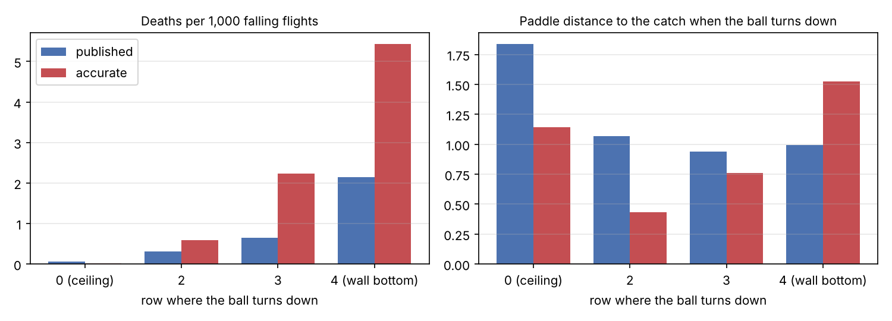

# What kills the accurate table (roadmap #13)

**Date:** November 16, 2026 · **Status:** done · **Cost:** CPU, about 15 minutes

[Roadmap #12](ROWSWAP.md) found that the author's ascending guesses beat a more accurate
table only in ball rows 3–5, and inferred why: a ball rising there may bounce off the wall
at once, leaving the least time of any flight. This experiment checks that directly by
tracing every falling flight and every death.

```bash
python experiments/breakout-anatomy/deaths.py CHECKPOINT --output runs/breakout-deaths
```

## Method

- A flight runs from the step the ball turns from rising to falling until it starts rising
  again (caught) or the episode ends (death). For each flight: the row where it turned down,
  the steps left before it reaches the paddle row, the paddle's distance from the nearest
  catch column at that moment (exact physics), and whether it ended in a death.
- The ball turns down at the ceiling (row 0) or under a brick it hit (rows 2–4; row 4 means
  it hit the bottom row of the wall, the shortest flight).
- The published table and #8's accurate table, on the same 300 episodes of the published
  protocol (sticky actions 0.1).

## Results (measured)

| Turned down at row | Published: flights | deaths | per 1,000 | distance | Accurate: flights | deaths | per 1,000 | distance |
|---|---:|---:|---:|---:|---:|---:|---:|---:|
| 0 (ceiling) | 33,104 | 2 | 0.06 | 1.84 | 42,415 | 1 | 0.02 | 1.14 |
| 2 | 40,972 | 13 | 0.32 | 1.07 | 20,224 | 12 | 0.59 | 0.43 |
| 3 | 49,096 | 32 | 0.65 | 0.94 | 28,630 | 64 | 2.24 | 0.76 |
| 4 (wall bottom) | 50,486 | **108** | 2.14 | 0.99 | 29,980 | **163** | **5.44** | **1.52** |
| all | 173,658 | 155 | 0.89 | | 121,249 | 240 | 1.98 | |



1. **Deaths come from the shortest flights.** Under both tables, about 70% of deaths
   (108 of 155; 163 of 240) follow a bounce off the bottom row of the wall, which leaves
   about 5 steps. Ceiling bounces almost never kill (3 deaths in 75,519 flights).
2. **On those flights the accurate table starts further away and dies 2.5 times as often.**
   When the ball turns at row 4, the paddle is 1.52 columns from the catch under the
   accurate table and 0.99 under the published one; deaths are 5.44 against 2.14 per 1,000.
3. **Distance at the turn is not the whole story.** At row 3 the accurate table is *closer*
   (0.76 against 0.94) yet dies 3.4 times as often (2.24 against 0.65 per 1,000).
4. Per flight the accurate table dies 2.2 times as often overall (1.98 against 0.89 per
   1,000), which matches its shorter episodes.

## Interpretation

- #12's mechanism holds where it matters most: the author's guesses put the paddle closer
  to the catch for the shortest flight, and that flight is where most deaths happen.
- *Inference, untested:* the row-3 result suggests the paddle's motion at the turn also
  matters, not only its position: a paddle still travelling toward an averaged guess may
  need to reverse, which costs steps the position alone does not show.

## Limits

- 300 episodes; deaths per row are small counts (12 to 163), so rates at rows 0–2 are rough.
- Distance is measured at the single step the ball turns down; paddle velocity and sticky
  overrides after the turn are not recorded.

Evidence: [`evidence/breakout-deaths/deaths.json`](../../evidence/breakout-deaths/deaths.json).
Code: `deaths.py`; 1 test in `tests/test_breakout_deaths.py`.
