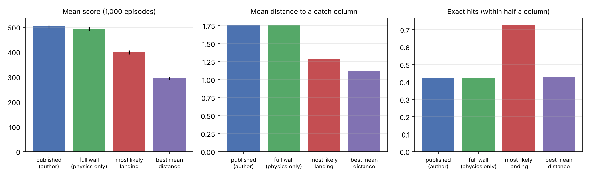

# Why the author's rough guesses win (roadmap #9)

**Date:** November 16, 2026 · **Status:** done; one hypothesis refuted, the winning table
reconstructed from physics, the mechanism still open · **Cost:** CPU, about 15 minutes

[Roadmap #8](TARGETS.md) found that the released network's ascending guesses (wrong by
1.76 columns on average) score 502.9, while a brick-blind table fitted to be more accurate
(1.12 columns) scores 294.1. This follow-up asks what the author's table gets right.

```bash
python experiments/breakout-anatomy/hedge.py CHECKPOINT --output runs/breakout-hedge
```

## Method

- **Earliest-bounce reconstruction.** Every episode starts with bricks in rows 1–3. For
  each ascending ball cell, the exact game physics (`anatomy.ball_future`) gives the catch
  columns if those bricks were all still there: the ball bounces off row 3, its earliest
  possible bounce. The "full wall" table takes the midpoint of those columns. No episodes
  are used.
- **Two fitted brick-blind tables**, from every ascending state of the published network's
  play in held-out episodes 5000–5049 (184,502 states, all 180 cells):
  - *deadline-aware*: per cell, the target that minimises how many moves the paddle
    would still need, beyond the descent time minus 2 steps, if it sat at the target
    when the ball turned down;
  - *most likely landing*: per cell, the target that most often lies within half a
    column of a true catch column.
- Each table is written into units 2 and 3 of the released weights (everything else
  unchanged) and scored at the published protocol: 1,000 episodes, sticky actions 0.1.

## Results (measured)

| Ascending table | Score (± se) | Mean distance to a catch column | Exact hits | Fitted on play? |
|---|---:|---:|---:|---|
| published (author) | **502.9 ± 7.7** | 1.76 | 42% | no |
| full wall (physics only) | **493.0 ± 7.9** | 1.76 | 42% | no |
| most likely landing | 398.2 ± 7.7 | 1.29 | **73%** | yes |
| best mean distance (#8) = deadline-aware | 294.1 ± 6.5 | **1.11** | 43% | yes |



1. **The author's guesses are the earliest-bounce landings.** On all 180 ascending cells
   the published target lies on one of the full-wall catch columns (within half a column).
   The full-wall table uses the midpoint of the catch columns instead, so it differs from
   the published one by 0.45 columns on average.
2. **Physics alone recovers 98% of the score.** The full-wall table, built without
   looking at a single episode, scores 493.0 against 502.9.
3. **The deadline hypothesis fails.** The deadline-aware fit came out identical to #8's
   best-mean-distance table on all 180 cells: under this model of the paddle, the
   accurate table is never late, so minimising lateness reduces to minimising distance.
   The published table is the *latest* of the four by the same model (late by a 2-step
   margin on 2.7% of states, against 0.0% for best-mean-distance).
4. **Exact hits explain part of the gap, not all of it.** Fitting for exact hits instead
   of mean distance lifts exact hits from 43% to 73% and the score from 294 to 398. The
   published and full-wall tables score another 95–105 points higher with only 42% exact
   hits and the worst mean distance.

## Interpretation

- No accuracy measure taken on the published network's own play ranks these tables
  correctly. The best-scoring tables are the least accurate by every such measure.
- *Inference, not tested:* the measures are computed on states the published network
  visits. Installing a different table changes which states occur, so a table fitted to
  the published play is fitted to a distribution it then leaves. The earliest-bounce
  table needs no fitting, so it cannot have this problem. A closed-loop fit (refit on the
  table's own play and repeat) would test this.
- *Inference:* the earliest bounce is the case with the least time left. When the guess is
  wrong because bricks are gone, the ball travels further and the descending code (which
  #2 found to be exact) has more time to correct. The crude lateness model above does not
  capture this, so the hedge idea is refuted only in that form.

## Limits

- One sticky-action probability (0.1) and one seed range for fitting and scoring.
- The lateness model assumes the paddle sits at the target when the ball turns down and
  then moves one column per step. The real paddle chases a moving target under sampled,
  sticky actions.

Evidence: [`evidence/breakout-hedge/hedge.json`](../../evidence/breakout-hedge/hedge.json)
(tables, comparisons, per-episode scores). Code: `hedge.py`; 5 tests in
`tests/test_breakout_hedge.py`.
