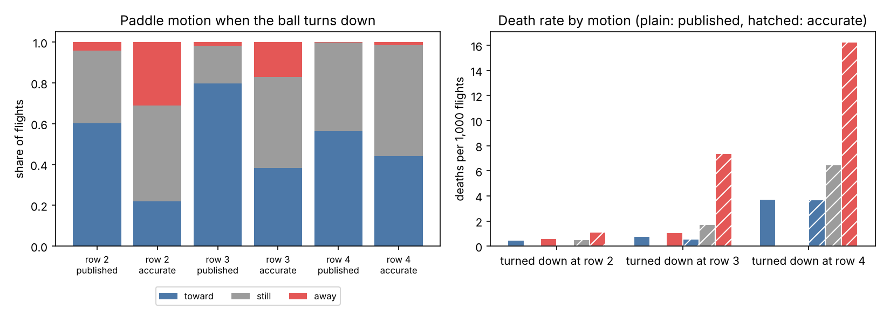

# Paddle motion at the turn (roadmap #15)

**Date:** November 16, 2026 · **Status:** done · **Cost:** CPU, about 15 minutes

[Roadmap #13](DEATHS.md) left one result unexplained. On flights that turn down at row 3,
the accurate table starts the paddle *closer* to the catch than the author's table (0.76
against 0.94 columns) yet dies 3.4 times as often, with five or more steps of slack. This
experiment follows each flight step by step to see what distance at the turn misses.

```bash
python experiments/breakout-anatomy/motion.py CHECKPOINT --output runs/breakout-motion
```

## Method

- Same 300 episodes, same two tables (published and #8's accurate) as #13. The run
  reproduces #13's flight and death counts exactly.
- For each falling flight that reaches the paddle row:
  - **motion at the turn**: over the step that ended when the ball turned down, did the
    paddle get closer to the catch (toward), further (away), or neither (still)?
  - **settled**: on a catch column one step before the ball arrives;
  - **late override**: a sticky action changed the executed move in the last two steps;
  - **out of reach**: fewer steps left at the turn than the paddle's distance.

## Results (measured)

| Turned down at | Table | toward / still / away | Deaths per 1,000: toward / still / away |
|---|---|---|---|
| row 3 | published | 80% / 19% / 2% | 0.77 / 0.11 / 1.09 |
| row 3 | accurate | 38% / 45% / 17% | 0.55 / 1.72 / **7.37** |
| row 4 | published | 57% / 43% / 0.3% | 3.75 / **0.05** / 0 |
| row 4 | accurate | 44% / 54% / 2% | 3.71 / 6.50 / 16.26 |



1. **The row-3 puzzle is direction, not distance.** Under the accurate table, 17% of
   row-3 flights start with the paddle moving away from the catch, against 2% for the
   author's table. Those flights die 7.4 times per 1,000 and account for 36 of the 64
   row-3 deaths. Giving the accurate table's per-motion death rates the author's motion
   mix yields 0.89 per 1,000 instead of 2.24 (the author's own rate is 0.65).
2. **The author's paddle is often already parked on the catch.** At row 4, 43% of the
   author's flights start with a still paddle, and those paddles are on the catch
   (mean distance 0.00): one death in 21,757 such flights. The accurate table's still
   paddles at row 4 are on average 1.10 columns off the catch and die 6.5 times per
   1,000.
3. **The two tables die in different ways.** 92 of the author's 155 deaths are out of
   reach: the ball turned down with fewer steps left than the paddle's distance, almost
   all at row 4 (85% of its row-4 deaths). Only 35 of the accurate table's 240 deaths are
   out of reach; 189 had a sticky action change the move in the last two steps, i.e. the
   paddle arrived just in time and one override cost the catch.
4. **The policy itself almost never fidgets.** The share of flights where the policy
   chose a move on the final step while already on the catch was 0 for both tables; when
   a settled paddle is knocked off, it is by a sticky repeat of the move that got it
   there.

## Interpretation

- *Inference:* the author's guesses do two things the accurate table does not. When the
  bet is right, the paddle is waiting at the catch before the ball turns, so sticky
  actions cannot hurt it. When the bet is wrong, the paddle is far away and cannot get
  there (the out-of-reach deaths): a few clean losses instead of many close calls.
- The accurate table spreads its error into close calls: paddles heading the wrong way
  or parked a column off, arriving on the last step, where a single override kills.
- This completes the account #12 and #13 started: the author's guesses trade a few
  unwinnable flights for many flights with time to spare.

## Limits

- 300 episodes; per-motion death counts are small outside rows 3 and 4 (the accurate
  table's row-4 "away" rate rests on 8 deaths in 492 flights).
- Motion is measured over a single step at the turn; the reweighting in result 1 is
  arithmetic on the measured rates, not a new run.

Evidence: [`evidence/breakout-motion/motion.json`](../../evidence/breakout-motion/motion.json).
Code: `motion.py`; 3 tests in `tests/test_breakout_motion.py`.
