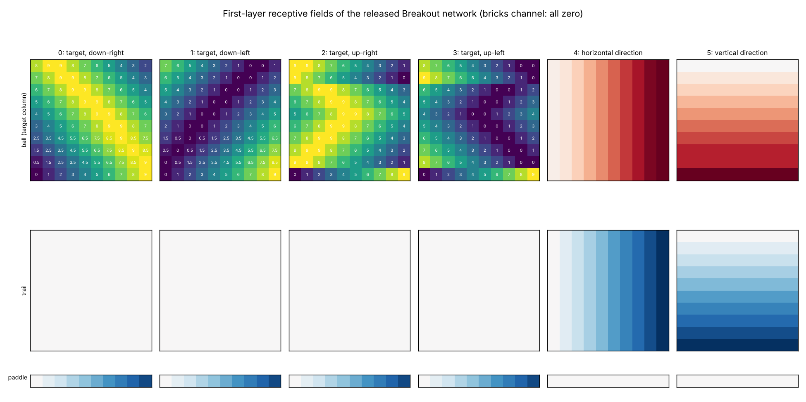
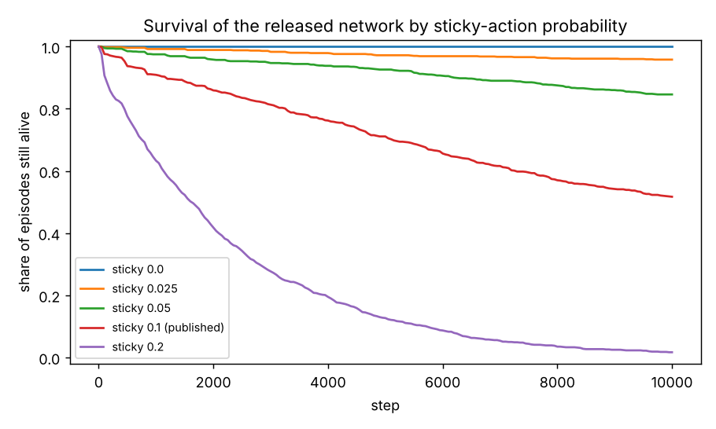

# Breakout: does the hand-written network do what its author said? (roadmap #2)

**Date:** November 16, 2026 · **Status:** complete for the released network · **Cost:** CPU,
about 45 minutes on 4 cores · **No model calls**

The released Takehi et al. Experiment 5 answer is a 600-32-32-6 tanh policy with 815
nonzero parameters ([pilot](../breakout-circuit/README.md)). Its author, a language
model writing weights without tools, described it as a program: four units that compute
"landing-position errors" (one per ball direction), two direction detectors, and a second
layer of gated left/right comparisons. This experiment checks that description against
the game, then tests which parts the score depends on.

```bash
python experiments/breakout-anatomy/anatomy.py all runs/breakout-full/reference/published.npz \
    --output runs/breakout-anatomy --episodes 1000 --semantic-episodes 20 --workers 4
```

## Method

- **Ground truth.** `ball_future` replays MinAtar's ball rules (walls, ceiling, bricks, the
  strike flag) until the ball reaches the paddle row and returns the two columns where
  the paddle survives. Paddle actions cannot change the ball's path before then, so this
  is exact. A test checks it against the real environment on every step of six episodes.
- **Semantics.** The intact network plays episodes 0–19 at the published protocol
  (158,482 states). At every state the script decodes unit *u*'s ball weight as a target
  column (weight ÷ 0.02, the scale of its paddle term), finds which of the four
  contexts the second layer selects from the signs of units 4 and 5, and compares both
  with ground truth.
- **Interventions** at the full protocol (1,000 episodes, 10,000-step ceiling, sticky
  actions 0.1, sampled softmax, per-episode seeds as `lab.py breakout`):
  - silence each second-layer unit (clamp it to −1, its idle value, so "this comparison
    never fires" without shifting its logit's baseline);
  - multiply every nonzero weight by (1 + σ·N(0,1)), σ ∈ {1%, 3%, 10%, 30%}, 3 draws each;
  - round the target code (units 0–3) to a grid of 0.04, 0.06 or 0.1, i.e. to 2, 3 or 5
    columns;
  - greedy actions instead of sampling;
  - sticky-action probability 0, 0.025, 0.05, 0.2 (the environment draws its random
    numbers identically at every setting, so ball starts are paired).
- **Check.** The intact run reproduces the committed full replay exactly (502.880 ± 7.747).

## Results (measured)

### The description is accurate where it matters

| What the author said | Measured on 158,482 states |
|---|---|
| Units 4 and 5 detect horizontal and vertical direction; the second layer picks one of four contexts from them | The selected context matches the ball's true next direction **99.4%** of the time (also 99.4% on wall-reflection frames) |
| Units 0 and 1 compute the descending landing column minus the paddle position, "including wall reflections" | The decoded target lies within half a column of a true catch column on **99.2%** of descending states; **100%** from row 3 down |
| Units 2 and 3 "anticipate the earliest possible brick bounce and revise as the ball climbs" | Within half a column on only **42%** of ascending states (mean error 1.76 columns). Error falls as the ball climbs: 37% in rows 4–8, 65% in row 2, 83% in row 1 |
| Bricks | The brick channel has no weights at all. The network cannot see bricks, which is why its ascending predictions are guesses |

One step before the ball reaches the paddle row, the paddle is on a catch column
**99.4%** of the time. Every decision the network made had a top-action probability of
at least 0.99.



### Every death is caused by the environment's injected noise

| Sticky-action probability | Mean score (SE) | Episodes reaching 10,000 steps |
|---:|---:|---:|
| 0 | **834.0 (0.0)** | **1,000 / 1,000** |
| 0.025 | 772.8 (3.4) | 958 |
| 0.05 | 696.3 (5.4) | 846 |
| **0.1 (published)** | 502.9 (7.7) | 517 |
| 0.2 | 149.3 (4.6) | 17 |

With sticky actions off, the network never misses: all 1,000 episodes survive to the
ceiling and every one scores exactly 834. The game then has only two trajectories (the
ball starts in one of two corners) and the policy is effectively deterministic. Greedy
action selection gives a result identical to sampling at every episode (502.88), so the
softmax sampling never matters. Every one of the 483 deaths in the published protocol
needs a sticky action: the environment repeating the previous move instead of the one
the network chose.



### Half of the second layer is nearly redundant

| Silenced second-layer unit | Context | Move | Mean score (SE) |
|---|---|---|---:|
| none | | | 502.9 (7.7) |
| 1 | descending right | right | **1.7 (0.1)** |
| 2 | descending left | left | **4.7 (0.1)** |
| 5 | ascending right | right | **8.3 (0.1)** |
| 6 | ascending left | left | **7.9 (0.1)** |
| 0 | descending right | left | 276.4 (7.0) |
| 3 | descending left | right | 277.3 (6.8) |
| 4 | ascending right | left | 485.7 (7.6) |
| 7 | ascending left | right | 490.3 (7.7) |

The four comparisons that move the paddle *with* the ball are each essential. The four
that move it *against* the ball matter less: silencing an ascending counter-move costs
3–4%, and silencing a descending one costs 45%. So the pilot's "no redundancy" holds at
layer 1 but not at layer 2.

### It is a precision program

| Change | Mean score |
|---|---|
| ×(1 + 1% noise), three draws | 18.9, 409.4, 491.3 |
| ×(1 + 3% noise), three draws | 9.8, 6.6, 2.3 |
| ×(1 + 10% or 30% noise) | at most 3.1 |
| Target code rounded to 2-, 3- or 5-column steps | 4.5, 5.0, 0.5 |

One percent multiplicative noise destroys play in one draw of three; three percent
destroys it in all three. The target code needs single-column resolution.

## Interpretation

- **The model's program is correct as a program.** In a noise-free game it plays forever.
  Its losses are entirely about recovery from a forced wrong move, which its design
  never considers: it plans as if every chosen action happens.
- **The ascending half is approximately wrong but essential.** It is off by about two
  columns half the time, yet silencing either ascending "move with the ball" comparison
  destroys play. Pre-positioning during the climb buys the paddle the time it needs to
  reach the exact descending target. Whether a better ascending guess would buy more
  survival is roadmap #8.
- **Why 1% noise can break it (inference, not tested separately).** The second-layer
  gates fire when 1000·|error| + 400 exceeds a bias of 415, a margin of 15 units. A 1%
  change to a ±1000 weight is ±10 and to the bias ±4, so small noise can open or close a
  gate at the wrong time.

## Limits

- Released network only. The fresh agent-written network (1,076 nonzero weights) is still
  not in this repository, so the released-versus-fresh comparison is not done.
- Semantics come from 20 episodes of the network's own play, so they cover the states it
  visits, not every reachable state.
- Noise uses three draws per scale; the 1% result is clearly bimodal, so a precise
  breaking threshold would need more draws.

Evidence: [`evidence/breakout-anatomy/`](../../evidence/breakout-anatomy/)
(`semantics.json`; `evaluations.json` with every variant's statistics and the episode
lengths behind the survival curves). The network and its description belong to
Takehi et al. (`RikiyaT/lm_understand-logs`, revision `4d09ba6`).

Follow-ups: [TARGETS.md](TARGETS.md) (roadmap #8, swapping the ascending guesses) and
[HEDGE.md](HEDGE.md) (roadmap #9, why the author's rough guesses win) and
[CLOSEDLOOP.md](CLOSEDLOOP.md) (roadmap #11, refitting the guesses on their own play) and
[ROWSWAP.md](ROWSWAP.md) (roadmap #12, the three rows where the author's guesses win).
