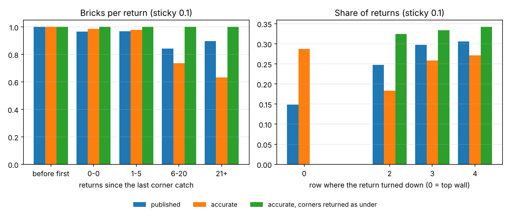

# Corner catches and the missing bricks (roadmap #17)

**Date:** November 16, 2026 · **Status:** done · **Cost:** CPU, about 30 minutes

[Roadmap #16](STICKY.md) found that without sticky actions nothing dies, yet the accurate
ascending table scores 569 against the author's 834, because fewer of its returns break a
brick. This experiment finds out why.

MinAtar Breakout catches a falling ball in one of two ways. In an **under** catch the paddle
is under the ball's current column, and the ball goes back up in the same horizontal
direction. In a **corner** catch the paddle is under the column the ball is about to enter,
and the ball goes back up with its horizontal direction reversed. The paddle has no other
effect on the ball. So once the bricks are fixed, the catch type alone decides where the
ball goes next.

```bash
python experiments/breakout-anatomy/returns.py CHECKPOINT --output runs/breakout-returns --episodes 200
python experiments/breakout-anatomy/returns.py CHECKPOINT --output runs/breakout-returns --cycle
```

## Method

- For every catch: its type, the column, the bricks broken before the next catch, and the
  row where the return turned back down (0 is the top wall, 2 to 4 is under a brick).
- Published table and #8's accurate table, without sticky actions (one episode, since
  every episode follows one cycle) and at the published sticky 0.1 (200 episodes, seeds
  as in the published protocol).
- **Counterfactual:** the accurate table, with every corner catch sending the ball back up
  as an under catch would. The paddle and the policy are unchanged; only the ball's
  horizontal direction after a corner catch is edited. This changes the game's physics, so
  it is an accounting tool, not a table anyone could write.

## Results (measured)

| Sticky 0.1, 200 episodes | Published | Accurate | Accurate, corners as under |
|---|---:|---:|---:|
| Mean score | 481.6 | 296.4 | 338.5 |
| Corner catches | 2.0% | 6.7% | 8.4% |
| Bricks per return | 0.90 | 0.80 | **1.00** |
| Returns that reach the top wall | 14.9% | 28.7% | 0% |
| Bricks per 10,000 steps | 700 | 584 | 834 |
| Deaths per 10,000 steps | 0.79 | 1.59 | 2.18 |
| Deaths per 1,000 returns turning at row 3 / row 4 | 0.69 / 2.36 | 2.20 / 5.65 | 1.42 / 6.14 |



1. **Without sticky actions, the two tables play the same game until the first corner
   catch.** The ball's path is identical for both tables until step 112, where the accurate
   table's paddle makes its first corner catch. It makes 19 in 10,000 steps; the author's
   makes none.
2. **The author's cycle never misses.** Without sticky actions its catches repeat every 30
   returns, one per brick in a wall, and land evenly on all ten columns (83 or 84 catches
   each). Every one of 833 returns breaks one brick. The accurate table's cycle is 78 returns
   long, uneven across columns, and 182 of its 733 returns break nothing, all of them caught
   in columns 0 to 6.
3. **The misses build up after each corner.** In the accurate table's no-sticky run, every
   return in the first five after a corner breaks a brick; 87% do 6 to 20 returns later, and
   61% after that. At sticky 0.1 the same pattern holds (0.98, 0.74, 0.63 bricks per return).
4. **Corner catches are the whole brick-rate effect.** Returning every corner catch as an
   under catch gives the accurate table exactly 834 bricks in 10,000 steps without sticky
   actions, the author's number. At sticky 0.1 every one of 67,680 returns then breaks
   exactly one brick, a better rate than the author's own 0.90.
5. **Corner catches also buy safety.** A return that breaks nothing goes to the top wall and
   comes back on the longest flight, the safest one (0.05 to 0.06 deaths per 1,000 returns).
   The counterfactual has none, so it dies more often (2.18 against 1.59 per 10,000 steps)
   and its score rises only from 296 to 338.
6. **What is left is safety on short flights.** With the brick rate fixed, the accurate
   table still trails the author's 482. Per return, the counterfactual dies twice as often as
   the author's table on flights turning at row 3 and 2.6 times as often at row 4.

## Interpretation

- The two jobs from #16 come apart cleanly. The author's table makes fewer corner catches,
  which keeps the ball in a cycle that breaks a brick on every return. Separately, it parks
  the paddle where short flights cannot catch it out (#12, #13, #15).
- *Inference:* a corner catch reverses the ball onto a path that soon runs through
  already-cleared columns, so returns start reaching the top wall. Why an all-under cycle
  always finds a brick is untested; it held on every return measured here.
- The accurate table's corner catches come from a paddle waiting one column ahead of the
  ball; [roadmap #18](UNDERFIT.md) measures this (95% to 97% of corner catches) and refits the
  table to the under column.
- Corner catches are not simply bad: the no-brick returns they cause are the safest flights
  in the game. The author's table gets a high brick rate without needing them for safety.

## Limits

- 200 episodes at sticky 0.1; the no-sticky numbers are one deterministic trajectory per table.
- The counterfactual edits physics, so it measures how much of the gap corner catches carry,
  not what any achievable table would score.

Evidence: [`evidence/breakout-returns/returns.json`](../../evidence/breakout-returns/returns.json)
and [`evidence/breakout-returns/cycle.json`](../../evidence/breakout-returns/cycle.json).
Code: `returns.py`; 4 tests in `tests/test_breakout_returns.py`.
