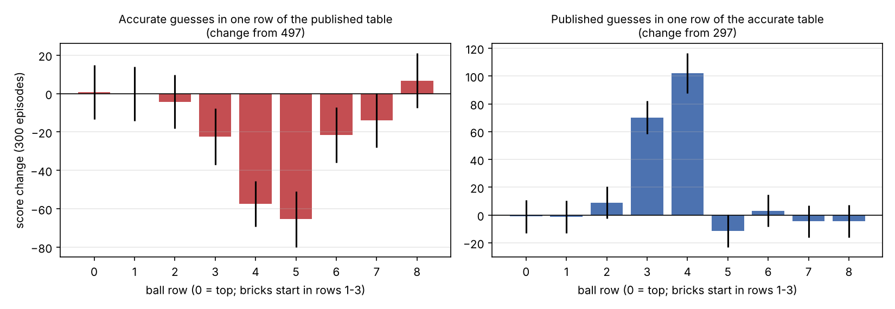

# Where the author's guesses win: three rows under the wall (roadmap #12)

**Date:** November 16, 2026 · **Status:** done · **Cost:** CPU, about 45 minutes

Roadmaps #8, #9 and #11 found that swapping the released Breakout network's ascending
guesses for a more accurate brick-blind table costs about 200 points, and that refitting
does not recover it. This experiment asks *where* on the board the loss comes from.

```bash
python experiments/breakout-anatomy/rowswap.py CHECKPOINT --output runs/breakout-rowswap
python experiments/breakout-anatomy/rowswap.py CHECKPOINT --output runs/breakout-rowswap --groups 3,4 3,4,5 2,3,4,5
```

## Method

- Two tables over the 180 ascending ball cells (rows 0–8, two directions): the author's
  (published) and #8's best-mean-distance table ("accurate"). They differ on 157 cells.
- For each ball row, swap that row's cells one way (accurate into published) and the other
  (published into accurate), then score on the first 300 episodes of the published protocol.
  Then swap groups of adjacent rows.

## Results (measured, 300 episodes, standard errors 12–15)

Published table 497.2; accurate table 297.0.

| Rows swapped | Accurate into published | Published into accurate |
|---|---:|---:|
| 0, 1, 2, 6, 7 or 8 alone | 475.6 to 503.9 | 292.4 to 306.0 |
| 3 alone | 474.7 | 367.0 |
| 4 alone | 439.8 | **398.9** |
| 5 alone | 431.8 | 285.5 |
| 3 and 4 | 384.9 | 413.5 |
| 3, 4 and 5 (54 cells) | **284.3** | **448.3** |
| 2, 3, 4 and 5 (70 cells) | 293.8 | 451.6 |



1. **Three rows carry almost the whole effect.** Putting the accurate guesses into rows
   3–5 alone (54 of 180 cells) drops the published network to 284, no better than the
   all-accurate table. Putting the author's guesses into rows 3–5 alone lifts the accurate
   table from 297 to 448, about three quarters of the way to the published score.
2. **Rows 3–5 are the bottom row of the brick wall and the two rows under it.** Rows 0–2
   (inside or above the wall) and 6–8 (near the paddle) change the score by at most 22
   points either way, under two standard errors.
3. **The rows interact.** Row 5 matters going one way (−65) but not the other (−11);
   rows 3 and 4 together matter more than the sum of either alone in the
   accurate-into-published direction.

## Interpretation

- *Inference:* a ball rising through rows 3–5 is about to hit the wall if the bricks above
  it are still there, and then comes straight back down with the least time left of any
  flight. The author's table assumes that bounce. When the guess is wrong because the
  bricks are gone, the ball flies to the ceiling and back, giving the exact descending code
  time to correct. The accurate table averages the two cases and is late for the short one.
- This refines #9's refuted deadline hypothesis rather than reviving it unchanged. #9's
  lateness model assumed the paddle had already reached the guessed column when the ball
  turned down; for a ball bouncing off the wall within one or two steps it has not, so the
  model could not see this cost.

## Limits

- 300 episodes per variant; single-row effects under about 30 points are within noise.
- Rows are a coarse partition. Columns and directions within rows 3–5 were not separated.
- The mechanism above is not tested directly. A direct test: measure, for deaths in the
  accurate table, the row at which the ball last ascended.

Evidence: [`evidence/breakout-rowswap/rowswap.json`](../../evidence/breakout-rowswap/rowswap.json)
(every variant's statistics and per-episode scores). Code: `rowswap.py`; 2 tests in
`tests/test_breakout_rowswap.py`.
