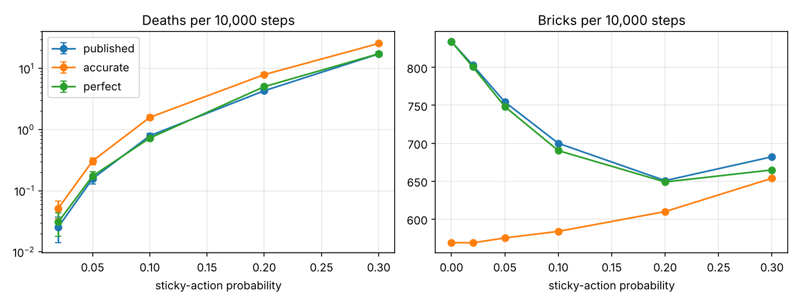

# Is the author's bet only a hedge against sticky actions? (roadmap #16)

**Date:** November 16, 2026 · **Status:** done · **Cost:** CPU, about 25 minutes

Roadmaps #12, #13 and #15 explain the author's ascending guesses as a hedge against
MinAtar's sticky actions: they put the paddle early, so a repeated move rarely costs a
catch. Two predictions follow. Without sticky actions the accurate table should do as
well as the author's, and its handicap should grow as sticky actions become more common.
This experiment tests both.

```bash
python experiments/breakout-anatomy/sticky_sweep.py CHECKPOINT --output runs/breakout-sticky --episodes 200
python experiments/breakout-anatomy/sticky_sweep.py CHECKPOINT --output runs/breakout-sticky --rallies 5
```

## Method

- Three variants: the published network, #8's accurate ascending table, and perfect
  prediction ("oracle-ascending", the true landing column fed to the rising-ball units).
- Sticky-action probability 0, 0.02, 0.05, 0.1 (the published setting), 0.2 and 0.3;
  200 episodes each, seeds as in the published protocol.
- Episodes cap at 10,000 steps, so scores mix two things. They are split into the death
  hazard (deaths per 10,000 steps, Poisson standard errors) and the scoring rate (bricks
  per 10,000 steps).
- Without sticky actions, 5 episodes per table also count paddle returns and bricks.

## Results (measured)

| Sticky | Published: score / deaths per 10k steps / bricks per 10k | Accurate | Perfect |
|---:|---|---|---|
| 0 | 834 / 0 / 834 | 569 / 0 / 569 | 834 / 0 / 834 |
| 0.02 | 790 / 0.025 / 803 | 554 / 0.051 / 569 | 784 / 0.031 / 801 |
| 0.05 | 696 / 0.16 / 754 | 499 / 0.31 / 575 | 690 / 0.17 / 748 |
| 0.1 | 482 / 0.79 / 700 | 296 / 1.59 / 584 | 476 / 0.73 / 690 |
| 0.2 | 149 / 4.3 / 651 | 77 / 7.9 / 610 | 129 / 5.0 / 649 |
| 0.3 | 40 / 17.3 / 682 | 26 / 25.6 / 654 | 38 / 17.3 / 665 |



1. **Without sticky actions the accurate table still loses.** All three variants survive
   every episode, but the accurate table scores 569 against 834. In 10,000 steps the
   author's paddle returns the ball 834 times and every return breaks exactly one brick;
   the accurate table's paddle returns it 734 times and only 569 returns break a brick.
   Every episode gives the same counts, for both tables.
   Sticky actions pull the two scoring rates together (the author's falls from 834 to
   682, the accurate table's rises from 569 to 654), which fits a fixed rally pattern
   that noise breaks up.
2. **The death handicap does not grow with sticky actions.** The accurate table dies about
   twice as often as the author's at every low setting (2.0, 1.95 and 2.0 times at 0.02,
   0.05 and 0.1), and less than that at 0.3 (1.5 times).
3. **At the published setting, over a third of the score gap is slower scoring.** At sticky 0.1
   the accurate table lives 26% fewer steps (5,078 against 6,882 on average) and scores
   17% fewer bricks per step (584 against 700). On a log scale, the scoring rate is about
   37% of the gap between 296 and 482.
4. **Perfect prediction matches the author's table, it does not beat it.** Its hazard is
   within about 20% of the author's at every setting, in both directions, and its score
   at 0.1 (476 ± 18) is within noise of the author's (482 ± 17) on these 200 episodes.

## Interpretation

- The sticky-action hedge (#12, #13, #15) is real but is only part of the story. The
  author's guesses also put the paddle where the return sends the ball into a brick. This
  half of the advantage needs no noise at all.
- *Inference:* where the paddle meets the ball decides the return angle (MinAtar flips the
  horizontal direction when the paddle is under the ball's next column, not its current
  one), so a table that is a column off changes the rally's path, not just its safety.
  That is untested.
- Prediction 2 is refuted in relative terms: the handicap is a roughly constant factor of
  two in hazard at low sticky rates, not one that grows.

## Limits

- 200 episodes per setting; the hazard at 0.02 rests on 5 to 10 deaths per variant.
- Without sticky actions every episode follows the same cycle, so the sticky-0 counts are
  one trajectory per table, not a sample.

Evidence: [`evidence/breakout-sticky/sticky.json`](../../evidence/breakout-sticky/sticky.json)
(every variant and setting, with per-episode scores) and
[`evidence/breakout-sticky/rallies.json`](../../evidence/breakout-sticky/rallies.json).
Code: `sticky_sweep.py`; 1 test in `tests/test_breakout_sticky.py`.
