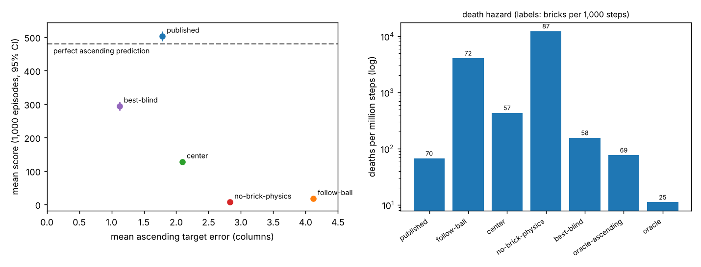

# Breakout: would a better guess keep the network alive longer? (roadmap #8)

**Date:** November 16, 2026 · **Status:** complete · **Cost:** CPU, about 20 minutes on 4
cores · **No model calls**

[Roadmap #2](README.md) found that the released network's ascending landing guesses are
off by more than a column about half the time (it cannot see bricks), yet the comparisons
that use them are essential. This experiment replaces only that ascending target code
(the ball weights of first-layer units 2 and 3) and asks whether better guesses help.

```bash
python experiments/breakout-anatomy/targets.py runs/breakout-full/reference/published.npz \
    --output runs/breakout-targets --episodes 1000 --workers 4
```

## Variants

All keep every other weight, the gating and the deadband. All run at the full protocol
(episodes 0–999, sticky actions 0.1, 10,000-step ceiling).

| Variant | Ascending target |
|---|---|
| published | the released weights |
| follow-ball | the ball's current column |
| center | column 4.5 |
| no-brick-physics | where the ball would land if there were no bricks |
| best-blind | per ball cell and direction, the column with the smallest mean distance to the true catch columns, fitted on held-out episodes 5000–5049 |
| oracle-ascending | the true landing column from the full game state, bricks included (not a network; an upper bound for ascending prediction) |
| oracle | no network: move toward the true catch columns every step |

Two extra measures: the ascending-target error along the published network's own
trajectories (episodes 6000–6009), and a **catch profile** on episodes 7000–7019: at
every moment the ball reaches the paddle row, how many steps the paddle had already
been still.

## Results (measured)

| Variant | Ascending error (columns) | Mean score (SE) | Reached 10k steps | Bricks per 1k steps | Deaths per 1M steps |
|---|---:|---:|---:|---:|---:|
| **published** | 1.78 | **502.9 (7.7)** | 51.7% | 70.0 | 67 |
| oracle-ascending | 0 | 480.6 (7.8) | 46.7% | 69.3 | 77 |
| best-blind | 1.12 | 294.1 (6.5) | 21.1% | 58.2 | 156 |
| center | 2.09 | 127.7 (4.2) | 2.4% | 56.9 | 435 |
| follow-ball | 4.12 | 17.6 (0.7) | 0% | 71.6 | 4,074 |
| no-brick-physics | 2.83 | 7.0 (0.1) | 0% | 86.9 | 12,357 |
| oracle (no network) | — | 231.7 (2.7) | **89.5%** | 24.6 | **11** |



1. **Perfect ascending prediction does not help.** Feeding the true landing column scores
   480.6, 22.3 ± 9.2 points *below* the published guesses on the same seeds. Its death
   hazard is about the same (77 versus 67 per million steps).
2. **A more accurate guess can be much worse.** The best brick-blind lookup table cuts the
   mean error from 1.78 to 1.12 columns, yet more than doubles the death hazard and
   loses 209 points.
3. **Almost every death is a last-moment arrival.** Across all variants, 97 of the 100
   deaths in the catch profiles came when the policy chose a move on the very step the
   ball reached the paddle row (in the other three the paddle had been still for two
   steps). For the
   published network, those last-moment catches are 0.7% of all catches and contain all 12
   of its deaths. A sticky action at that step replays the previous action instead of the
   needed move.
4. **The network trades survival for score.** The pure oracle survives six times longer
   per step (11 versus 67 deaths per million steps; 89.5% of episodes reach the
   ceiling) but breaks bricks at a third of the rate (24.6 versus 70.0 per 1,000 steps),
   so it scores less than half as much. Which catch column the paddle uses decides where
   the ball goes next, and the network's choices aim the ball at bricks.

## Interpretation

- Ascending accuracy is not what limits the network. Its losses come from how often the
  paddle arrives just in time, and that depends on the whole catch strategy, not on the
  average distance of the guess.
- Why the published guess beats the more accurate table is **not settled here**. One
  hypothesis, untested: the author's guesses assume the *earliest* possible brick
  bounce, which is the case with the least time left, so they hedge against the worst
  case rather than the average one.
- Score and survival pull apart. A post that ranks Breakout policies by score alone hides
  that the hand-written network is a deliberate risk-taker.

## Limits

- One network, one game. The catch profiles cover 20 episodes per variant (100 deaths
  in total), enough for the "last-moment arrival" pattern but not for precise per-variant
  rates.
- "Same seeds" differences are not truly paired once two policies' trajectories diverge;
  the SE treats them as paired.
- The best-blind table is fitted on the published network's trajectories, which change
  once the table is in use.

Evidence: [`evidence/breakout-targets/targets.json`](../../evidence/breakout-targets/targets.json)
(every variant's statistics, the catch profiles and the fitted table).
