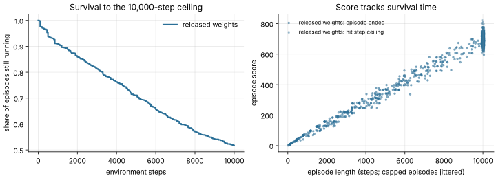

# Breakout: does the score measure survival time?

**Date:** November 10, 2026 · **Cost:** reads retained episode records; no simulation

`analyze.py` reads the per-episode records of a full Breakout evaluation (an
`evaluation.json` from `lab.py breakout`, or its `evidence.json` export) and asks how
much of the mean score comes from how long episodes last under the 10,000-step ceiling.

```bash
python experiments/breakout-ceiling/analyze.py evidence/breakout-full-replay/evidence.json \
    --label "released weights" --output runs/breakout-ceiling
```

## Results: released Experiment 5 network, 1,000 episodes

The input is a fresh full replay run on November 10, 2026. It reproduced the recorded
local mean exactly: **502.880 (SE 7.747)**, versus the published 517.411 (SE 7.417).

| Measure | Value |
|---|---:|
| Episodes reaching the 10,000-step ceiling | 517 / 1,000 (51.7%) |
| Mean score, capped episodes | 697.5 |
| Mean score, episodes that ended | 294.6 |
| Correlation of score with episode length | r = 0.992 (R² = 0.983) |
| Points per step (linear fit) | 0.069 |
| Share of episodes still running at 1k / 5k / 10k steps | 90.9% / 71.1% / 51.7% |
| Score percentiles 10 / 50 / 90 | 95 / 645 / 731 |

Episode length explains 98% of the variance in episode score, and the scoring rate is
nearly constant (10th–90th percentile 0.065–0.084 points per step). The reported mean
is therefore mainly a measure of **how long the policy keeps the ball in play before
the step ceiling**, and it is capped. More than half the episodes are cut off, so the
mean depends directly on the 10,000-step protocol limit. Comparing networks by their
survival curves would separate "plays longer" from "scores faster".



The fresh agent-written network (mean 511.530) is not in this repository, so its
survival curve has not been compared; see the [roadmap](../../docs/ROADMAP.md).
Survival beyond 10,000 steps is censored, and nothing here estimates scores under a
higher ceiling.
