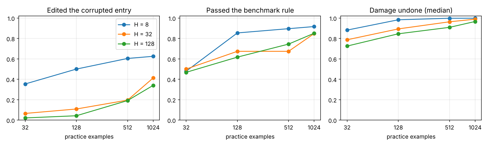

# How many examples does it take to find the broken weight? (roadmap #10)

**Date:** November 16, 2026 · **Status:** done · **Cost:** CPU, about 40 minutes ·
**No model or API calls**

[Roadmap #7](README.md) found that an editor not told which entry is broken still passes
the benchmark about half the time, but in a 642-parameter network it edits the corrupted
entry in only 3% of cases. This sweep asks whether that is a shortage of data: it keeps
each case's corruption and held-out test fixed and grows only the practice set.

```bash
python experiments/locate-repair/practice_size.py --widths 8 32 128 --seeds 50 --output runs/practice-size
```

## Method

- Cases from `analyze.py`'s generator: widths H = 8, 32 and 128 (42, 162 and 642
  parameters), seeds 0–49.
- Practice sets of 16, 64, 256 and 512 examples per stratum (32 to 1,024 examples in all),
  drawn with the benchmark's own dataset builder. The held-out set and success rule are
  unchanged.
- The min-change editor from #7: for every entry, find its smallest practice-perfect edit
  (on a 1e-2 grid within ±4, coarser than #7's 1e-3), then pick the smallest relative
  change.
- A case is kept only if it can supply every practice size (the corruption must disagree
  with the teacher on enough inputs). 9 of 150 cases were dropped, leaving 46–48 per width.

## Results (measured)

| H | Practice examples | Edited the corrupted entry | Passed the rule | Passes that edit a different entry | Damage undone (median) | Entries with a practice-perfect edit (median) |
|---:|---:|---:|---:|---:|---:|---:|
| 8 | 32 | 35% | 48% | 10 of 23 | 88% | 5 |
| 8 | 1,024 | 63% | 92% | 15 of 44 | 100% | 2 |
| 32 | 32 | 7% | 50% | 22 of 23 | 79% | 32.5 |
| 32 | 1,024 | 41% | 85% | 20 of 39 | 99% | 2 |
| 128 | 32 | 2% | 47% | 21 of 22 | 73% | 130 |
| 128 | 1,024 | 34% | 85% | 25 of 40 | 97% | 5 |



1. **More data helps a lot with passing.** From 32 to 1,024 practice examples, the not-told
   editor's pass rate rises from 47–50% to 85–92%, about what the told editor reaches.
2. **It helps much less with finding the fault.** At 642 parameters, the share of cases
   where the editor edits the corrupted entry rises from 2% to 34%. Even with 1,024
   examples, more than half of all passes (25 of 40) edit a different entry.
3. **The wrong-entry passes stop being partial repairs.** Median damage undone rises from
   73–88% to 97–100%, and the number of entries with a practice-perfect edit falls from
   130 to 5 at H = 128. With enough data, the entries that still pass are ones that can
   genuinely stand in for the broken one.
4. The location-given editor stays at 77–98% throughout. Its slight drop at the largest
   sizes is the coarser value grid: fewer true-entry edits are perfect on 1,024 examples
   at 1e-2 resolution.

## Interpretation

- Scarce practice data is why #7's not-told editor passed with partial repairs. With
  enough data, a passing edit undoes nearly all the damage. It just often isn't at the
  broken weight.
- *Inference:* in these ReLU networks, several entries can compensate for one corrupted
  entry almost everywhere in input space. "Which weight is broken" then has no
  behavioural answer, and a locate-and-repair benchmark that scores localization needs
  corruptions that no other single entry can absorb.

## Limits

- One corruption size (1.6 standard deviations), one architecture family, 46–48 cases per
  width. Dropping cases that cannot supply 1,024 examples removes the smallest-footprint
  corruptions, which are the hardest to localize.
- The value grid is 1e-2 here and 1e-3 in #7, so the 32-example row differs slightly from #7.

Evidence: [`evidence/practice-size/practice-size.json`](../../evidence/practice-size/practice-size.json)
(per-case rows, summary, dropped cases). Code: `practice_size.py`; 2 tests in
`tests/test_practice_size.py`.
