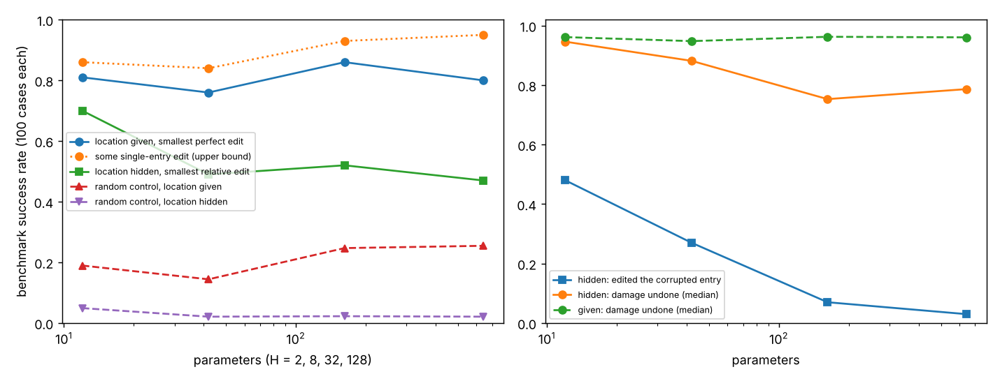

# Locate-and-repair: passing the test by fixing the wrong weight (roadmap #7, offline half)

**Date:** November 16, 2026 · **Status:** reference strategies done; model editors not run ·
**Cost:** CPU, about 5 minutes · **No model or API calls**

The editing benchmark names the entry to change, so it measures arithmetic and tool
discipline but not *finding* a fault. This analysis removes that hint and asks what
model-free strategies can do, as the network grows.

```bash
python experiments/locate-repair/analyze.py --widths 2 8 32 128 --seeds 100 --output runs/locate-repair
```

## Task

- A 2-input ReLU network with H ∈ {2, 8, 32, 128} hidden units and 2 outputs: 5H + 2
  parameters (12 to 642).
- A random teacher (redrawn if it predicts one class almost everywhere). One entry,
  chosen uniformly among all parameters, is shifted by ±1.6 times its tensor's standard
  deviation. Entries whose corruption is (nearly) invisible are redrawn: the task needs
  16 practice and 128 held-out inputs the corruption gets wrong.
- Practice and held-out sets, and the success rule, are the benchmark's own
  (`weight_space_lab.benchmark_tasks._dataset`): 16 + 16 practice examples; on 256
  held-out examples, at least 90% repair and zero regressions.
- The editor may change any one entry. It sees all weights and the practice inputs, and
  one no-change feedback call gives it all 32 practice labels.

## Strategies

| Strategy | What it does |
|---|---|
| given | Told the entry; takes its smallest edit that is perfect on practice (the best strategy in [task geometry](../task-geometry/README.md)) |
| min-change | Not told; for every entry finds its smallest practice-perfect edit, then picks the entry whose edit is smallest relative to its tensor's spread |
| any | Whether *some* entry's smallest practice-perfect edit succeeds (upper bound for rules that pick among them) |
| random / random-given | The benchmark's scripted random control: three uniform values in [−3, 3], chosen by practice accuracy, then fewer practice regressions; random entry, or the true one |

Values are searched on a 1e-3 grid within ±4 of the current value. "Damage undone"
compares the network with the teacher on 20,000 uniform inputs: 1 means it agrees
everywhere again, 0 means no better than before the edit.

## Results (measured, 100 cases per width)

| H | Parameters | given | min-change | any | random-given | random | min-change edited the corrupted entry | Entries with a practice-perfect edit (median) |
|---:|---:|---:|---:|---:|---:|---:|---:|---:|
| 2 | 12 | 81% | 70% | 86% | 19.0% | 4.9% | 48% | 2 |
| 8 | 42 | 76% | 49% | 84% | 14.4% | 2.1% | 27% | 6 |
| 32 | 162 | 86% | 52% | 93% | 24.7% | 2.3% | 7% | 25 |
| 128 | 642 | 80% | 47% | 95% | 25.5% | 2.1% | **3%** | 104 |



1. **Hiding the location costs about 30 points, and the cost stops growing.** Against
   the location-given strategy, min-change loses 11 points at 12 parameters and 27–34
   points from 42 to 642 parameters, holding near 50%. The hypothesized collapse with
   size does not happen.
2. **Localization does collapse.** The min-change editor edits the corrupted entry in 48% of
   cases at H = 2 and 3% at H = 128. At H = 128, 44 of its 47 successes edit a *different*
   entry.
3. **Some single edit almost always passes.** The share of cases where at least one entry's
   smallest practice-perfect edit meets the rule grows from 86% to 95% with size; at
   H = 128 a median of 16 different entries pass.
4. **Passing the rule is not the same as undoing the damage.** Told the location, the
   smallest edit undoes a median 95–96% of the damage at every size. Not told, min-change
   undoes 95% at H = 2 but 75–79% at H ≥ 32. Among min-change *successes* at H = 32 and
   128, 15–19% undo less than half the damage.
5. **The random control stays near 2%** without the location, against 14–26% with it.

## Interpretation

- In bigger networks there are many single edits that restore behaviour on the inputs the
  benchmark samples, and practice data rarely singles out the real fault. An editor
  that only needs to pass the rule does not need to find the bug; an editor judged on
  finding it would fail almost always.
- A located benchmark should therefore score localization separately from passing, or
  test on dense inputs near the damaged region, or both.
- The corruption's footprint shrinks with width (median damage 14.9% of input space at
  H = 2, 1.5% at H = 128), which is part of why other entries can compensate. This is a
  property of the task generator, not only of the networks.

## Limits

- Model editors (the roadmap's main arms) were not run: they need paid API calls or CLI
  allowance and explicit approval.
- One corruption size (1.6 standard deviations) and one architecture family. The
  generator redraws invisible corruptions, so every case has a visible fault.
- Min-change is one reasonable selection rule among many; "any" bounds what a better rule
  could reach with practice data alone.

Evidence: [`evidence/locate-repair/locate-repair.json`](../../evidence/locate-repair/locate-repair.json)
(per-case rows and the summary). Code: `analyze.py`; 4 tests in `tests/test_locate_repair.py`.

Follow-up: [PRACTICE.md](PRACTICE.md) (roadmap #10) grows the practice set from 32 to
1,024 examples.
[SUBSTITUTES.md](SUBSTITUTES.md) (roadmap #14) asks which entries stand in for the
broken one: an exact output-logit mirror, or units that point the same way.
[TWO_FAULTS.md](TWO_FAULTS.md) (roadmap #20) breaks two entries at once: passing repairs at
H = 32 mostly touch neither, and only a told joint search reliably fixes both.
[PAIR_SEARCH.md](PAIR_SEARCH.md) (roadmap #21) searches pairs of entries: practice data
often fits several pairs perfectly, so even an exhaustive search finds the broken pair only
about half the time.
[ACTIVE_QUERIES.md](ACTIVE_QUERIES.md) (roadmap #22) asks the teacher about inputs where the
candidate pairs disagree: 64 such examples settle most cases that 1,024 random ones could not.
[PAIR_SCREEN.md](PAIR_SCREEN.md) (roadmap #23) screens all pairs cheaply so the search reaches
H = 32: a coverage screen ranks the broken pair about nine times better than a Newton screen.
[ACTIVE_SCREEN.md](ACTIVE_SCREEN.md) (roadmap #24) runs the targeted queries at H = 32 on
screened candidates: they find the broken pair in 12 of the 13 cases whose candidates include it.
[CANDIDATE_RECALL.md](CANDIDATE_RECALL.md) (roadmap #25) keeps more candidates: the broken pair is found in
18 of 25 width-32 cases, and every visible fault in 21.
[JOINT_SCREEN.md](JOINT_SCREEN.md) (roadmap #26) screens every pair with a 13 × 13 joint fit: with 48 targeted
queries it finds every visible fault in 25 of 25 width-32 cases.
[THREE_FAULTS.md](THREE_FAULTS.md) (roadmap #27) breaks three entries at H = 16: the pair screen still finds
two of them, but practice data alone picks all three in only 5 of 25 cases.
[TRIPLE_QUERIES.md](TRIPLE_QUERIES.md) (roadmap #28) adds targeted examples for three faults: all three
found rises from 5 to 10 of 25, and the grid fit, not the data, limits the rest.
[WARM_TRIPLES.md](WARM_TRIPLES.md) (roadmap #29) fits each triple from its last round's values: the true
triple keeps a perfect fit, and all three faults are found in 12 of 25 cases.
[TRIPLE_RECALL.md](TRIPLE_RECALL.md) (roadmap #30a) ranks three-fault suspects: refinement helps, and the
coarse grid works partly because one of its points sits next to the corruption size.
[RANDOM_SIZES.md](RANDOM_SIZES.md) (roadmap #31) re-tests the pair and triple screens with bug sizes their
grids cannot match: recall drops, so the earlier headline numbers were partly a grid coincidence.
[DENSE_SCREEN.md](DENSE_SCREEN.md) (roadmap #32) makes the screens denser: the pair pipeline finds every visible
fault in 23 of 25 random-size cases, and the triple ranking improves only to 14.
[CONTINUOUS_TRIPLES.md](CONTINUOUS_TRIPLES.md) (roadmap #33) fits every three-fault suspect continuously: the true
triple fits practice perfectly, but so do a median 160 others.
[TRIPLE_COMMITTEE.md](TRIPLE_COMMITTEE.md) (roadmap #34) asks the teacher where 200 suspects disagree: all three
faults found in 16 of 25 random-size cases, every visible fault in 19.
[BOUNDARY_QUERIES.md](BOUNDARY_QUERIES.md) (roadmap #35) draws those queries near the suspects' decision boundaries:
17 of 25 all three, 19 every visible fault, about level with uniform queries.
[LOOKALIKES.md](LOOKALIKES.md) (roadmap #36) checks the repaired networks' behaviour on a million inputs: 22 of 25
match the original network on all but 0.1%, though only 16 to 17 edit the exact broken entries.
[BEHAVIOUR_SCORES.md](BEHAVIOUR_SCORES.md) (roadmap #37) probes every round's winner: three-fault repairs behave
like the original much sooner than their entries say (16 against 9 of 25 after 16 labels), while four two-fault
repairs edit the exact weights and still miss by 0.13% to 0.17%, so two-fault behaviour ends at 20 of 25, not 23.
[VALUE_QUERIES.md](VALUE_QUERIES.md) (roadmap #38) fixes those misses: a finer local fit plus labels aimed at
the winner's values brings 24 of 25 two-fault repairs under 0.1% and 20 under 0.01%, against 20 and 9.
[SWITCH_QUERIES.md](SWITCH_QUERIES.md) (roadmap #39) switches to those value queries once the committee agrees:
level on behaviour (24 and 19) with every visible fault back at 23, but it reaches the 0.01% line later.
[TRIPLE_VALUES.md](TRIPLE_VALUES.md) (roadmap #40) gives three-fault repairs the same value queries: 24 of 25 under 0.1%
and 19 under 0.01% (#37: 22 and 16), but every visible fault drops from 19 to 17, the same trade as for two faults.
[SWITCH_TRIPLES.md](SWITCH_TRIPLES.md) (roadmap #41) tries #39's switch rule on three faults: the committee almost
never runs out of splits, so only 101 of 1,600 labels become value queries and the result is #37's exactly.
[SWITCH_LINE.md](SWITCH_LINE.md) (roadmap #42) moves the trigger to the 0.1% line (fewer than 20 pool inputs split
the committee): it fires in 23 cases, but under 0.01% falls from 16 to 13 and under 0.1% stays at 22, so dropping
every committee label at the line hurts.
[HALF_LINE.md](HALF_LINE.md) (roadmap #43) keeps half the labels on committee splits past the same line: #42's loss
is undone but nothing is gained (22 and 16, #37's cases exactly), because the cases #40 fixes reach the line late or never.
[EARLY_VALUES.md](EARLY_VALUES.md) (roadmap #44) reverses that: #40's mix in the first four rounds, then committee splits only. It keeps both gains: 24 of 25 under 0.1% as in #40, and 19 every visible fault as in #37, with half #40's value queries.
[SWITCH_POINT.md](SWITCH_POINT.md) (roadmap #45) moves the switch: two early rounds (200 value queries) is the best three-fault arm so far, 24 of 25 under 0.1% and 20 under 0.01%, with #37's weights exactly; six early rounds is worse on every count.

[FRESH_SWITCH.md](FRESH_SWITCH.md) (roadmap #46) checks #45 on 25 fresh cases: 2 early rounds no longer beat 4 (15 and 16 under 0.01%), but over all 50 cases early value labels put 48 under 0.1% against 45 without them, with the same weights; one early round loses seed 17, and the committee misses the true triple in 8 fresh cases, including seed 49, the one clear failure.
