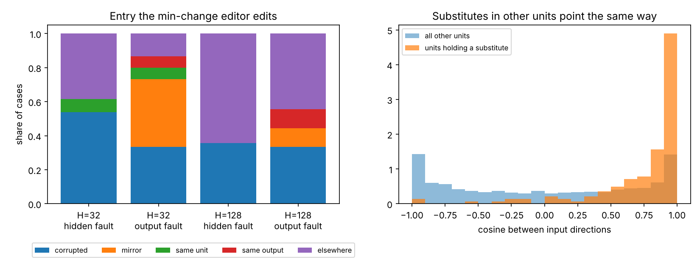

# Which weights stand in for the broken one (roadmap #14)

**Date:** November 16, 2026 · **Status:** done · **Cost:** CPU, about 25 minutes

[Roadmap #10](PRACTICE.md) found that with 1,024 practice examples the not-told
min-change editor passes 85–92% of cases with near-complete repairs, yet most of its
passing edits change an entry other than the corrupted one. This experiment asks which
entries those are and why they work.

```bash
python experiments/locate-repair/substitutes.py --widths 32 128 --seeds 50 --output runs/substitutes
python experiments/locate-repair/substitutes.py --merge runs/substitutes/substitutes.json \
    --output evidence/substitutes --figure experiments/locate-repair/figures/substitutes.png
```

## Method

- Same cases as #7 and #10: 2-input ReLU networks with H hidden units and one corrupted
  entry; 50 seeds per width, H = 32 and 128. Seven cases cannot supply 1,024 practice
  examples and are skipped (4 at H = 32, 3 at H = 128), leaving 46 and 47.
- For every entry, the benchmark's smallest practice-perfect edit on 1,024 examples. A
  **substitute** is any other entry whose edit passes the benchmark rule and undoes at
  least 95% of the corruption's damage on 20,000 uniform inputs.
- Each substitute is classed against the corrupted entry:
  - **mirror:** the same hidden unit's weight into the *other* output logit (or the
    other output bias);
  - **same unit:** another entry of the same hidden unit;
  - **same output:** another entry feeding the same output logit;
  - **elsewhere:** anything else.
- For substitutes in a different hidden unit, the cosine between the two units' input
  directions (the rows of `hidden_weight`), against the cosine to every other unit.
- The editor's own pick is recorded too: the entry with the smallest relative change
  among all practice-perfect edits.

## Results (measured)

| | H = 32 | H = 128 |
|---|---:|---:|
| cases | 46 | 47 |
| corrupted entry repairs (passes, ≥95% undone) | 83% | 96% |
| cases with at least one substitute | 50% | 64% |
| substitutes: mirror / same unit / same output / elsewhere | 13 / 15 / 2 / 22 | 18 / 11 / 8 / 121 |
| share of all other entries that are mirror or same unit | 2.5% | 0.7% |
| "elsewhere" substitutes whose unit has direction cosine > 0.9 | 55% (of 22) | 48% (of 119) |
| all other units with cosine > 0.9 (same cases) | 15% | 16% |



1. **Output-weight faults always have an exact twin.** The network classifies by
   comparing its two logits, so shifting the same unit's weight into the other logit by
   the opposite amount restores every decision exactly. In all 37 output-layer cases
   (all of them output weights; no output bias was corrupted) the mirror repairs
   exactly when the corrupted entry does: 19 of 19 at H = 32, 18 of 18 at H = 128.
   No amount of behavioural data can tell these two entries apart.
2. **The editor often picks the twin.** Among cases with any practice-perfect edit, the
   min-change editor edits the corrupted entry in 19 of 41 cases at H = 32 and the mirror
   in another 6; counting the mirror as found raises localization from 46% to 61%. At
   H = 128 it picks the mirror in only 2 of 46 (35% to 39%).
3. **Substitutes in other units sit in units that point the same way.** For "elsewhere"
   substitutes, the median cosine between input directions is 0.94 at H = 32 and 0.89
   at H = 128, against 15–16% of all other units above 0.9. A near-parallel unit can
   absorb the broken unit's error over most of the input space.
4. **The corrupted entry is almost always a valid repair.** Failure to localize is a
   choice among several near-complete repairs, not a failure to find one: the true entry
   qualifies in 83% and 96% of cases.

## Interpretation

- *Inference:* at H = 32 the "wrong weight" passes in #7 and #10 are partly a scoring
  artifact. Mirror edits are not wrong; they are the same repair. A localization score
  for 2-class networks should treat the mirror as equivalent, or the benchmark should
  report logit-difference symmetry explicitly.
- At H = 128 most of the editor's picks (26 of 46) are elsewhere, so the artifact does
  not explain the wider network's low localization. There, near-duplicate units are the
  likelier cause, but only 8 of the editor's 26 elsewhere picks are near-complete
  substitutes; the rest pass the benchmark rule (or fail it) with a partial repair, so
  the editor is also choosing worse repairs than the ones available.

## Limits

- One corruption size (1.6 standard deviations), two widths, 2-class tasks only. The
  mirror symmetry is specific to comparing two logits; a softmax over more classes has a
  weaker version (adding the same amount to every logit).
- "Near-complete" is a 95% threshold on uniform inputs in [−2, 2]²; a different input
  distribution could rank substitutes differently.
- The figure's chance histogram pools only cases that have an other-unit substitute.

Evidence: [`evidence/substitutes/substitutes.json`](../../evidence/substitutes/substitutes.json)
(per-case substitutes, editor picks and summary). Code: `substitutes.py`; 5 tests in
`tests/test_substitutes.py`.
