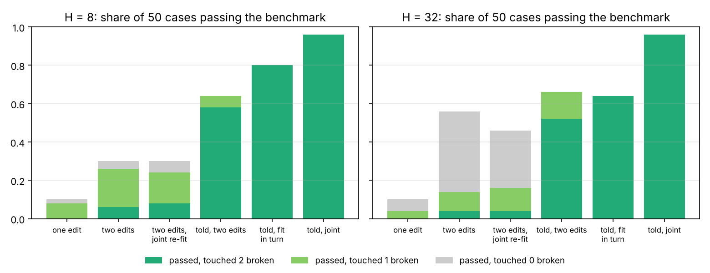

# Two broken weights (roadmap #20)

**Date:** November 16, 2026 · **Status:** done · **Cost:** CPU, about 10 minutes

[Roadmap #14](SUBSTITUTES.md) found that a single corrupted entry almost always has a stand-in:
an exact mirror in the other output logit, or a unit pointing the same way. A one-edit
repair can then pass the benchmark without touching the broken entry. This experiment
breaks two entries in different hidden units, so that no single edit can undo both. It
asks three questions. Does the benchmark still pass repairs that miss the faults? How much
of the gap is finding the entries, and how much is fitting their values?

```bash
python experiments/locate-repair/two_faults.py --widths 8 32 --seeds 50 --output runs/two-faults
python experiments/locate-repair/two_faults.py --output runs/two-faults --figure two-faults.png
```

## Method

- The cases are #7's 2-input ReLU networks with H hidden units and one corrupted entry,
  plus a second corrupted entry, drawn at random from a different hidden unit (and never
  the first entry's mirror). Both shifts are 1.6 standard deviations of their tensor.
  H = 8 and 32, 50 seeds each, and none was skipped.
- 1,024 practice examples (512 repair, 512 protected), as in #10 and #14. Success is the
  benchmark rule on 256 held-out examples: repair accuracy at least 90% and no regressions.
  Damage undone is measured on 20,000 uniform inputs.
- Repairs, all model-free:
  - **one edit:** #7's min-change rule, the smallest practice-perfect single edit;
  - **two edits:** the single edit with the best practice accuracy, then the smallest
    practice-perfect edit on the result (or the best-accuracy one if none is perfect);
  - **two edits, joint re-fit:** the same two entries, re-fitted together on a
    200 × 200 grid;
  - **told:** the same three procedures, restricted to the two corrupted entries. "Fit in
    turn" re-fits each in turn for up to six passes.
  - **restored:** both entries put back to the teacher's values. It passes in all 100 cases,
    so the rule itself can be met.
- An edit counts as touching a broken entry when it changes that entry or its exact mirror.

## Results (measured)

| Repair | H = 8: pass / touched both / median damage undone | H = 32 |
|---|---|---|
| one edit | 10% / 0% / 1.00 | 10% / 0% / 0.98 |
| two edits | 30% / 8% / 0.88 | 56% / 4% / 0.90 |
| two edits, joint re-fit | 30% / 8% / 0.77 | 46% / 4% / 0.87 |
| told, two edits | 64% / 82% / 0.97 | 66% / 76% / 0.97 |
| told, fit in turn | 80% / 100% / 0.99 | 64% / 100% / 0.98 |
| told, joint | **96%** / 100% / 0.99 | **96%** / 100% / 0.99 |

Damage undone for "one edit" is over the 5 cases with a practice-perfect candidate.



1. **One edit almost never passes.** Only 5 of 50 cases at each width have a
   practice-perfect single edit. With one fault, #10's min-change editor passed 85–92%.
2. **At H = 32, most passing repairs touch neither broken entry.** The two-edit repair
   passes 28 of 50 cases, and 21 of those 28 change neither broken entry nor its mirror.
   Those 21 still undo a median 90% of the damage. At H = 8 the two-edit repair passes
   15 cases, and only 2 of them touch neither broken entry.
3. **Finding the entries is the gap, not fitting them.** Told where the faults are and
   searching both values together, the repair passes 48 of 50 cases at both widths. Given
   the two entries the untold repair chose, the same joint search passes 30% and 46%: the
   chosen pair was the wrong pair.
4. **Fitting one entry at a time stalls even on the right pair.** Re-fitting the true
   entries in turn reaches 80% at H = 8 and 64% at H = 32, against 96% for the joint
   search. A fit to one entry while the other is still broken lands on a value that
   compensates for the other, and the next pass cannot climb out of it.

## Interpretation

- *Inference:* the benchmark rule is weakest exactly where the damage is small. At H = 32
  the two faults change a median 4.6% of the input space (10.3% at H = 8). Two edits
  anywhere that reshape that small region pass the rule. A wider network has more such
  entries, which is why the untold repair passes more often at H = 32 than at H = 8 while
  finding the faults less often.
- This extends #14 from "a fault has a twin" to "a pair of faults has many look-alike
  pairs". An editor judged on passing the rule is not judged on finding the bug.
- Result 4 is a property of greedy coordinate search on a step-shaped objective (practice
  accuracy). A smooth loss, or a joint search, would likely avoid it; that is untested.

## Limits

- 50 cases per width, so each rate has a standard error of about 7 points. H = 128 was not
  run (the greedy search scales with the parameter count).
- The joint grid spans 2.5 standard deviations at a step of about 0.025, and does not
  contain the 1.6-deviation shift exactly. The one-dimensional searches use #10's grid
  (±4 at a step of 0.01).
- One corruption size and one architecture family; model editors were not run.

Evidence: [`evidence/two-faults/two-faults.json`](../../evidence/two-faults/two-faults.json)
(per-case rows, edits and the summary). Code: `two_faults.py`; 2 tests in
`tests/test_two_faults.py`.
