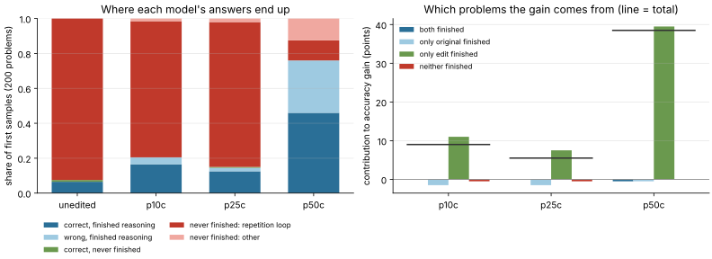

# Is p50c a math edit or a stop-thinking edit? (roadmap #1)

**Date:** November 14, 2026 · **Status:** first result, from the released full-run records ·
**Cost:** CPU, about 10 seconds · **No model inference**

**Question.** The published p50c edit to Qwen3.5-0.8B raises MATH-500 accuracy from 7.9% to
48.1%. Does it make the model better at mathematics, or does it mostly let the model *finish*?

## Data

The analysis uses Takehi et al.'s released evaluation records
([`exp8_math/eval/`](https://github.com/RikiyaT/lm_understand-logs/tree/4d09ba6d6a7e891dd8063974dfe81b3d78e3494f/exp8_math/eval),
revision `4d09ba6`, CC BY 4.0). They were not produced by this lab. The records come
from the full upstream evaluation of the unedited model and the three agent-written
edits:

- **p10c:** loop-direction removal from 30 matrices.
- **p25c:** one attention head switched off.
- **p50c:** loop-direction removal from 64 MLP output columns in each of layers 15 and 19.

Every run used 500 problems × 4 samples, a 32,768-token ceiling and the same sampling.

| What is released | Coverage | Used for |
|---|---|---|
| Per-problem correctness of every sample, shard aggregates (correct, capped, tokens) | 2,000 samples per arm | Accuracy, intervals, bounds |
| Full text of sample 0 for the first 20 problems of each shard | Problems 0–199, 200 samples per arm | Closure, loops, paired attribution |

Checks: the per-problem records reproduce every published aggregate exactly (for
example, unedited 7.90% accuracy with 93.0% capped, p50c 48.10% with 33.05% capped).
This lab's grader reproduces the recorded grade on **800 of 800** transcripts.

## Method

`qwen/termination.py` measures each transcript from its text alone:

- **closed:** `</think>` is present, so the model ended its reasoning.
- **boxed:** a final `\boxed{}` answer exists.
- **found:** any `\boxed{}` anywhere, reasoning included, verifies as the gold answer.
- **lenient:** if there is no box, whether a "Final Answer: X" phrase verifies.
- **loop:** the zlib compression ratio of the last 20,000 characters is below 0.1. A
  repetition loop compresses more than 10×.

Samples of each edit and the unedited model are paired by problem and split by which
model closed its reasoning. The accuracy difference equals the sum of the four cells'
contributions, so the table shows where the gain comes from. Intervals are 95%
bootstraps over problems (10,000 replicates).

```bash
git clone https://github.com/RikiyaT/lm_understand-logs && git -C lm_understand-logs checkout 4d09ba6d6a7e891dd8063974dfe81b3d78e3494f
python qwen/termination.py upstream lm_understand-logs/exp8_math/eval runs/termination --source-revision 4d09ba6d6a7e891dd8063974dfe81b3d78e3494f
```

The roadmap planned token-budget curves. They are implemented (`budget_curve`, tested)
but not yet run, because this session could not download the Qwen tokenizer. The
closure design answers the same question without tokens.

## Results

**Accuracy over all 2,000 samples** (difference against the unedited model, with 95% interval):

| Arm | Accuracy | Capped at 32,768 tokens | Gain over unedited |
|---|---:|---:|---:|
| unedited | 7.90% [6.10, 9.90] | 93.0% | — |
| p10c | 12.35% [10.20, 14.65] | 87.3% | +4.45 [2.80, 6.15] |
| p25c | 14.10% [11.80, 16.50] | 86.4% | +6.20 [4.55, 7.90] |
| p50c | 48.10% [44.35, 51.75] | 33.1% | **+40.20 [36.85, 43.55]** |

**Where p50c's gain comes from** (sample 0 of problems 0–199; gain +38.5 points [31.5, 45.5]):

| Unedited closed reasoning? | p50c closed? | Problems | Unedited correct | p50c correct | Contribution |
|---|---|---:|---:|---:|---:|
| yes | yes | 12 | 12 | 11 | −0.5 |
| yes | no | 1 | 1 | 0 | −0.5 |
| **no** | **yes** | **140** | **2** | **81** | **+39.5 [32.5, 46.5]** |
| no | no | 47 | 0 | 0 | 0.0 |

1. **All of the gain comes from problems where the original never finished reasoning.**
   That cell contributes 103% of the difference. On the 12 problems where both models
   finished, the edit adds nothing: 11 correct versus 12, a difference of −8.3 points
   [−28.6, 0].
2. **The original was not "done but unable to stop". It was stuck.**
   - 185 of its 187 unfinished samples (98.9%) end in a repetition loop, and that share
     is 98.4–98.9% at thresholds from 0.05 to 0.2.
   - The loop starts at a median of 22% of the way through the text.
   - In **78 of the 81** problems p50c rescued, the original never put the right answer
     in a `\boxed{}` anywhere in its 32,768 tokens.
3. **The two weaker edits behave the same way.**
   - p10c: the rescued cell holds 31 problems (1 → 23 correct); both-finished problems
     go 10/10 → 10/10.
   - p25c: the rescued cell holds 20 problems (1 → 16); both-finished go 9/9 → 9/9.
   - Each also stops finishing 3–4 problems the original had solved, losing 3 correct
     answers apiece.
4. **p50c's remaining failures are partly loops that moved.**
   - 42 of its 200 samples close their reasoning but give no boxed answer, and 26 of
     those 42 end in a repetition loop *in the answer section* (for example, "Wait, I
     will provide the answer…" repeated).
   - Only 4 would be correct under a lenient reading, so missing boxes cost about 2
     points.
   - Of its 48 never-closed samples, 38–92% are loops, depending on the threshold.
5. **Graded-while-unfinished answers exist at full scale.** From the aggregates alone,
   at least 0.9 points of the original's 7.9% come from capped samples, because its
   accuracy (7.9%) exceeds its finish rate (7.0%). In the transcripts, 2 of its 15
   correct answers come from unfinished reasoning.

**Interpretation.** On this evidence, p50c is best described as an **anti-loop edit**: it
lets the model escape repetition, and the model then solves most problems that it
previously never got through. This matches upstream's own description of the edit as
removing a "loop direction". The roadmap hypothesis ("gain mostly from finishing; little
difference among finished samples") is supported. The "stop-thinking" framing needs
correcting: the original was not withholding answers it had already reached.

## Limits

- Text, not the engine's finish reason, defines "closed". A sample can close its
  reasoning and still be cut off while answering; these are counted as closed.
- Transcripts cover sample 0 of the first 200 problems, a fixed subset rather than a
  random one. Its accuracy is close to the full set's (unedited 7.5% vs 7.9%; p50c 46.0%
  vs 48.1%).
- Only 12 problems have both models finishing, and they are easy (the original solves
  all 12). This cannot rule out a reasoning gain on harder problems.
- What the original would have done past its loop is not observable, so a reasoning
  change on the rescued problems cannot be fully excluded.
- "Found" counts only `\boxed{}` answers. An original trace that reached the right value
  without boxing it counts as "never wrote it", so 78/81 is an upper bound on that claim.
- The data are upstream's, not this lab's GPU run. Token-budget curves and the lab's
  own paired run remain to be done ([roadmap](../../docs/ROADMAP.md) #1).

Evidence: [`evidence/qwen-termination/`](../../evidence/qwen-termination/), with the
summary plus per-sample measures (hashed problem IDs, no text or answers).


