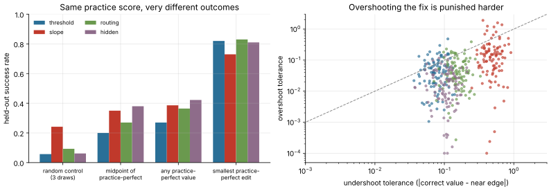

# Task geometry: how precise must a one-entry repair be?

**Date:** November 10, 2026 · **Cost:** CPU only, about 10 minutes · **No model or API calls**

Every editing-benchmark task has exactly one editable entry, so its whole
behaviour is a function of one number. `analyze.py` sweeps that number over
[-3, 3] (step 1e-4) for 100 task seeds in each of the four families and records:

- the **success window**: the values that meet the benchmark rule on the
  256-example held-out draw (repair accuracy ≥ 90% and zero regressions);
- the **practice-perfect window**: the values that score 32/32 on practice;
- how reference strategies do, including the benchmark's scripted random control
  (three uniform draws, chosen by practice accuracy, then by fewer regressions),
  replicated 4,000 times per case.

Held-out seeds are fixed and declared (`seed + 10_000_000`), so the analysis can be
rerun exactly. Real campaigns draw a private held-out seed per case, so individual
windows differ there, but the distributions should match.

```bash
python experiments/task-geometry/analyze.py --seeds 100 --output runs/task-geometry
python experiments/task-geometry/analyze.py --from-cases evidence/task-geometry/cases.json --output runs/task-geometry-summary
```

## Results (400 cases)

| Family | Success-window width, median (relative to the correct value) | Random control (3 draws) | Any practice-perfect value | Midpoint of practice-perfect window | Smallest practice-perfect edit |
|---|---:|---:|---:|---:|---:|
| threshold | 0.122 (20%) | 5.7% | 27% | 20% | **82%** |
| slope | 0.629 (55%) | 24.2% | 39% | 35% | **73%** |
| routing | 0.207 (79%) | 9.3% | 36% | 27% | **83%** |
| hidden | 0.130 (42%) | 6.2% | 42% | 38% | **81%** |

In every case the correct (teacher) value succeeds, and each window is one interval.

1. **The random baseline is about 11%, not "1 in 12".** The mean random-control success
   rate over all 400 cases is 11.4%, or 1.36 expected successes per 12 cases. The 1/12
   recorded in the verification guide and the 2/12 from today's rerun are both
   ordinary draws from that rate.
2. **A perfect practice score does not certify a repair.** If an editor picks any
   value that scores 32/32 on practice, it passes the held-out rule only 27–42% of the
   time.
3. **Overshooting is punished far harder than undershooting.** The rule allows 10%
   unrepaired examples but zero regressions. The median overshoot tolerance (0.015–0.14)
   is 2–7 times smaller than the undershoot tolerance, and it is the smaller of the two
   in 75–96% of cases. Most of the practice-perfect window lies past the correct value,
   so aiming for its middle overshoots; the **smallest edit that is perfect on
   practice** succeeds 73–83% of the time.

This helps explain the recorded Codex CLI pilot: 255/256 final accuracy with 100% repair
and a single protected regression is what a slight overshoot looks like.
An editor that requests one no-change feedback call obtains all 32 practice labels and
can compute the smallest practice-perfect edit exactly from the visible weights and
inputs.



Evidence: [`evidence/task-geometry/`](../../evidence/task-geometry/) (per-case windows
and the summary). Limits: four synthetic one-entry tasks; window widths are resolved
to the 1e-4 grid; strategy rates assume an editor that reaches the named value exactly.
